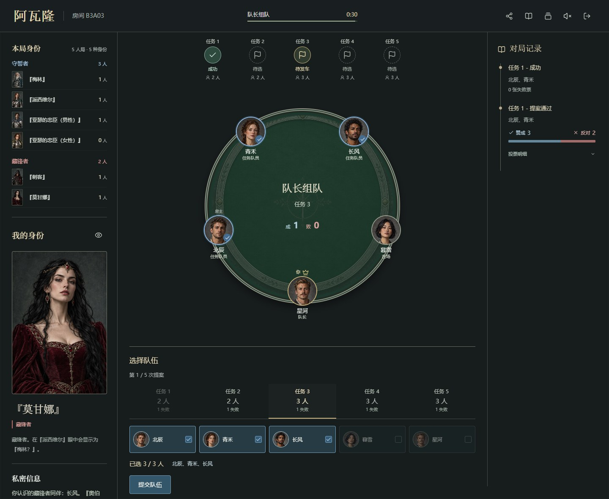
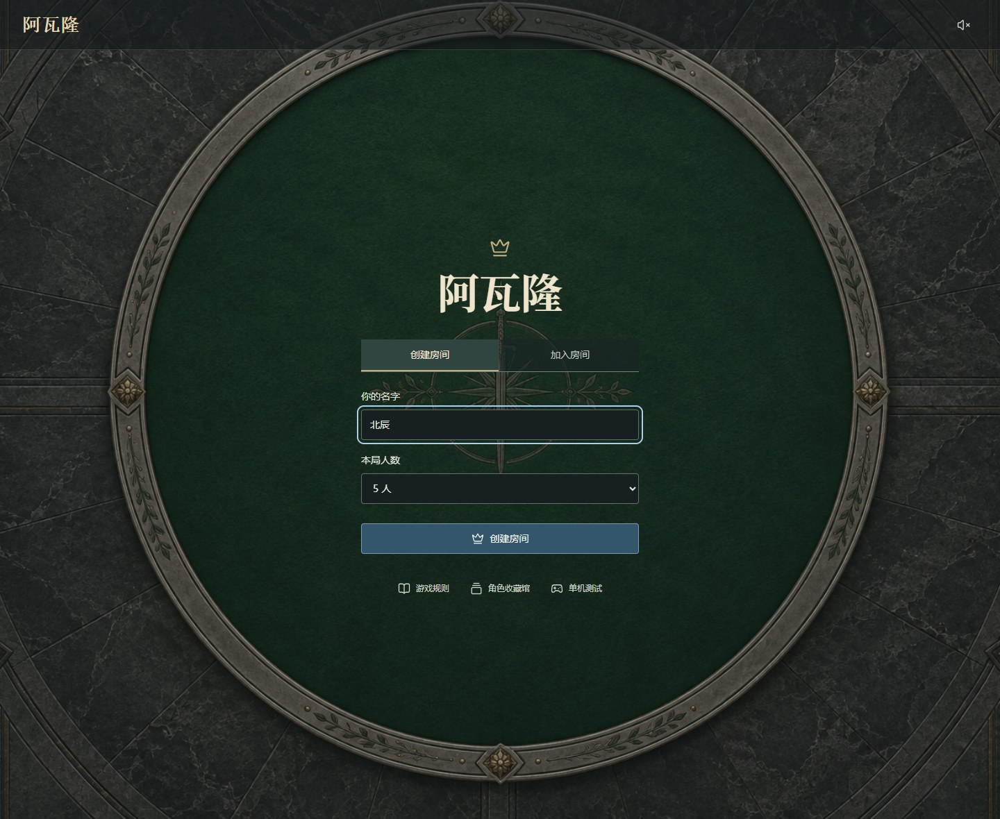
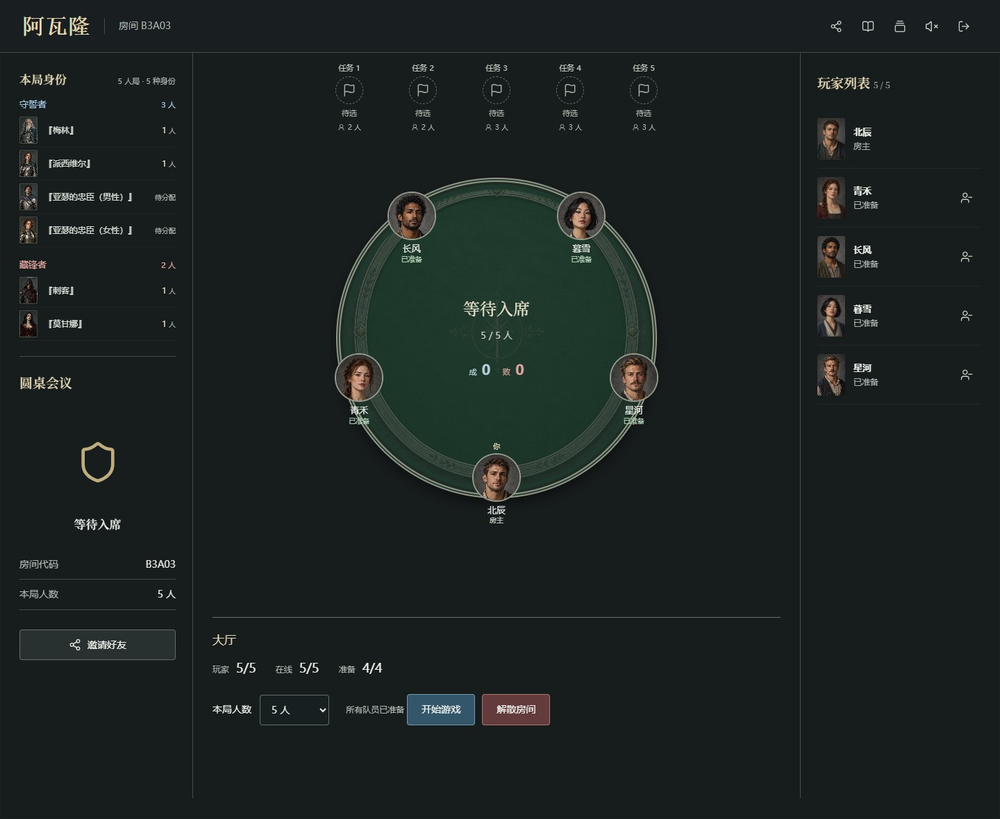
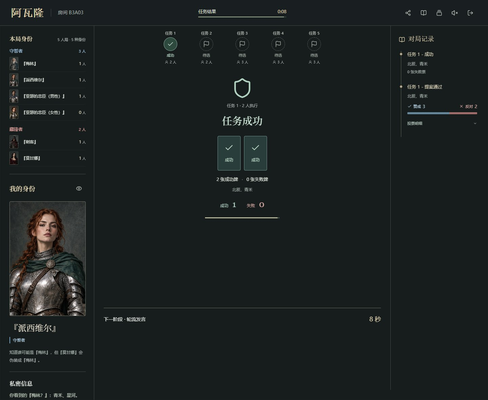
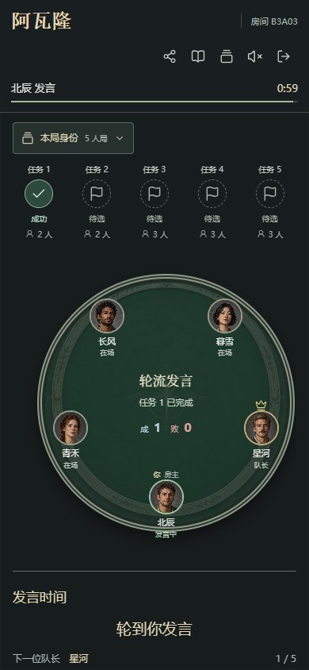

# ⚔️ Avalon

> 把朋友叫齐，开一桌阿瓦隆。

Avalon（阿瓦隆）是一个在浏览器里玩的 5–10 人社交推理游戏。取个名字、输入入场暗号，就可以创建房间，或加入朋友的对局，不需要注册账号。

同一个 Wi-Fi 下可以一起玩；部署到自己的服务器后，异地的朋友也能加入。还没约齐人？可以先开一局单机，让 AI 补齐其他玩家，熟悉一下流程。


[](LICENSE)

[🚀 快速开始](#快速开始) · [🖼️ 游戏展示](#游戏展示) · [🎭 角色典藏馆](#角色典藏馆) · [📖 游戏规则](docs/user-guide/rules.md) · [🌐 部署指南](docs/deployment/README.md)



*挑一项任务，选几位同伴。这一车，你会投赞成还是反对？*

## ✨ 这一桌能玩什么

- 👥 **和朋友组局**：5–10 人房间，支持邀请、准备、取消准备和断线重连。
- 🎭 **各自藏好身份**：自己的角色卡可以随时查看或收起，圆桌上的公共头像不会泄露身份。
- 🗳️ **把一局完整玩下来**：从组队、表决、秘密提交任务牌，到轮流发言和最后的刺杀阶段。
- 📜 **回头看看谁投了什么**：点开已完成的任务，就能查看队长、队员和公开表决。任务牌只公布数量，不公布是谁出的。
- 🤖 **一个人也能先试试**：可选 5–10 人局，由规则 AI 补齐玩家，不需要接入大模型。
- 🔊 **有音乐，也有旁白**：等待与对局使用不同音乐，任务结果有独立音效，固定旁白从本地播放。
- 🎙️ **想直接聊，可以接语音**：可选 LiveKit 实时通话，发言权限随游戏阶段切换，不保存录音。
- 💾 **掉线不用急着重开**：支持重连和服务重启恢复，房间、身份、投票与剩余时间保存在 SQLite 中。

发车和发言顺序与常见桌游版本有些不同，开局前可以看一眼[游戏规则](docs/user-guide/rules.md)。

## 快速开始

准备好 **Node.js 22.13+** 和 npm，获取项目并安装依赖：

```bash
git clone https://github.com/cailishy/avalon.git
cd avalon
npm ci
```

第一次运行时，用 `.env.example` 创建本机配置。如果已经有 `.env`，保留它，不要覆盖。

Linux / macOS：

```bash
cp .env.example .env
```

Windows PowerShell：

```powershell
Copy-Item .env.example .env
```

打开 `.env`，把 `GAME_ACCESS_CODE` 设为自己的入场暗号。这个值必须填写，也别把它提交到仓库里。随后启动：

```bash
npm run dev
```

在浏览器打开 [http://localhost:3000](http://localhost:3000)，输入暗号就能开房了。让同一局域网里的朋友访问启动日志中给出的局域网地址；如果连不上，先检查主机防火墙和路由器是否允许设备互访。

项目使用 Node.js 内置的 `node:sqlite`。想部署到公网，请使用[生产部署指南](docs/deployment/README.md)，不要直接暴露开发服务。

## 游戏展示

从入席到任务结算，页面会跟着对局推进。投票、倒计时和结果由服务器校验，不靠反复刷新整页来同步。

| 🏰 创建与加入 | 👥 等大家准备好 |
| --- | --- |
| [](docs/images/entry.jpg) | [](docs/images/lobby.jpg) |

| 🛡️ 任务结果 | 📜 回看这一车 |
| --- | --- |
| [](docs/images/mission-result.jpg) | [](docs/images/quest-details.jpg) |

### 📱 手机也能入席

不用安装客户端，打开同一个游戏地址就能加入。

[](docs/images/mobile.jpg)

## 角色典藏馆

先认认这桌可能遇到的人。下面每张卡都可以单独点开；具体出场身份取决于对局人数。男女忠臣是同一种身份的两张卡面，能力相同。

### 🛡️ 守誓者

| 『梅林』 | 『派西维尔』 |
| :---: | :---: |
| [](docs/images/roles/merlin.jpg) | [](docs/images/roles/percival.jpg) |

『梅林』知道许多身份，却得藏好自己。『派西维尔』看见两位『梅林？』，得自己分清真假。

| 『亚瑟的忠臣』· 男性 | 『亚瑟的忠臣』· 女性 |
| :---: | :---: |
| [](docs/images/roles/servant-male.jpg) | [](docs/images/roles/servant-female.jpg) |

『亚瑟的忠臣』没有额外情报，靠发言、投票和任务结果判断。两张卡面，同样的身份与能力。

### 🗡️ 藏锋者

| 『刺客』 | 『莫甘娜』 |
| :---: | :---: |
| [](docs/images/roles/assassin.jpg) | [](docs/images/roles/morgana.jpg) |

『刺客』等到刺杀阶段，再提交心中的『梅林』。『莫甘娜』在『派西维尔』眼中，也是『梅林？』。

| 『莫德雷德』 | 『奥伯伦』 |
| :---: | :---: |
| [](docs/images/roles/mordred.jpg) | [](docs/images/roles/oberon.jpg) |

『莫德雷德』不在『梅林』的情报里，其他线索仍可能出卖他。『奥伯伦』不知道同伴是谁，同伴也不知道他。

卡面和游戏截图来自实际页面，来源与更新方式见[图片说明](docs/images/README.md)。

## 🌐 联机与语音

| 玩法 | 需要什么 |
| --- | --- |
| 🏠 同一局域网 | 一台主机运行服务，其他人用浏览器访问它的局域网地址 |
| 🌍 异地联机 | 把游戏部署到可访问的 HTTPS 域名，所有人连接同一个服务 |
| 🎙️ 游戏内语音 | 可选 LiveKit，需要可信 HTTPS、可达的媒体端口和必要的 TURN |

公网部署默认接入服务器已有的 Caddy，不需要再叠一层网关。具体配置见[部署指南](docs/deployment/README.md)，不同网络与终端的条件见[网络支持](docs/user-guide/networking.md)。

语音不是必装项，不配 LiveKit 也能玩、也能听旁白。语音默认只收听，主动开启麦克风后才会申请权限。除本机 localhost / 127.0.0.1 外，浏览器麦克风需要可信 HTTPS；项目不保存录音。

## 🛠️ 开发

想改界面，从 `src/client/` 开始；想改房间、规则执行或存档，从 `src/server/` 开始。共享规则和通信协议放在 `src/shared/`。整体设计见[架构说明](docs/development/architecture.md)。

前端使用 TypeScript、Vite 和 morphdom；后端使用 Node.js、Express、Socket.IO 和 SQLite。日常开发常用这几条命令：

```bash
npm run check       # 仓库、文档、lint、类型与单元测试
npm run build:e2e   # 隔离构建，不覆盖在线 dist
npm run test:e2e    # 多人浏览器回归，需安装 Playwright Chromium
```

生产构建使用 `npm run build`，启动使用 `npm start`。开发环境和完整检查命令见[贡献指南](CONTRIBUTING.md)与[测试说明](docs/development/testing.md)。

## 📄 许可

项目自有代码、配置、测试和文档采用 [MIT](LICENSE)。图片、音乐、图标和旁白不统一适用代码许可；各资源的来源、许可及分发限制见[素材授权说明](docs/media/licensing.md)与[第三方声明](THIRD_PARTY_NOTICES.md)。

本项目为非官方实现，不代表原游戏权利人的认可，也不附带官方素材或商标授权。
