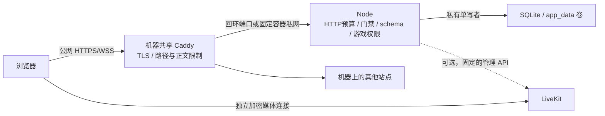

# HTTPS 与实时语音部署

## 边界与准备

不同网络、终端与真人语音的适用条件见 [网络支持矩阵](../user-guide/networking.md)。游戏 HTTPS 可用不代表媒体可达，也不表示本机测试已覆盖目标服务器、移动网络或 TURN。

这是交付给维护者、用于其他服务器的可迁移部署方案，不要求提供服务器凭证，也不在开发电脑执行公网部署。应用是单进程邀请制游戏，私有 SQLite 支持重启/崩溃后恢复，不能直接启动多个副本。防护不能保证免受所有攻击；本机已完成原生网关回环与强制进程恢复验证，Linux 容器运行及证书签发需在目标环境验收。

默认使用服务器已有的标准 Caddy，不再依赖 Nginx，也不要求安装 Caddy 扩展。基础游戏需要 Linux 服务器、Docker Engine/Compose 和可解析的游戏域名；现有 Caddy 管理证书。没有网关才选择可选独立 Caddy profile。实时语音是可选组件，不需要 LiveKit 也能运行游戏；启用时另配浏览器可访问的 LiveKit WSS 服务，不自动创建收费账号或上传密钥。非容器部署最低 Node.js 22.13，使用带安全补丁的受支持版本。

游戏服务与媒体服务是两个独立组件。媒体自托管请按 [LiveKit 部署指南](https://docs.livekit.io/transport/self-hosting/deployment/) 和 [端口说明](https://docs.livekit.io/transport/self-hosting/ports-firewall/) 配置 TLS、公网 ICE 地址及 TURN。信令通了不代表音频通了，必须跨网络实测。不要将本机 `.media/livekit.yaml` 用于公网。

## 配置

### 先确认部署身份

首次部署可选固定的 `COMPOSE_PROJECT_NAME=avalon`。**已有部署必须保留原项目名与数据卷**：先用 `docker compose ls` 及原来的启动参数确认名称，不要直接套用示例中的 `avalon`。更改项目名、`-p` 参数或卷绑定会选择另一组数据，表现为“房间消失”；本次不自动迁移、清空或重命名任何现有卷。

以下命令从仓库根目录执行。配置工具需要 Node.js 22.13+ 和 `npm ci` 安装的开发依赖，不在仅含生产依赖的运行容器里执行。没有宿主机 Node 时可使用下方手工配置流程。

### 生成与离线预检

新部署可以生成私有配置；将示例域名换成自己的真实域名：

```bash
npm ci
npm run deploy:init -- --domain game.your-domain.tld --project avalon
npm run deploy:check
npm run deploy:caddy
```

`deploy:init` 独占创建 `deploy/.env.public`，使用 32 字节密码学随机值生成入场暗号，POSIX 权限为 `0600`，不在终端输出暗号。已有文件一律拒绝覆盖，不会修改根 `.env`。需要使用暗号时仅在可信终端本地查看该文件；不要把它提交、粘贴到 Issue 或发送给他人。Windows 需另设文件 ACL。

`deploy:check` 不启动服务、不查询 DNS、不连接 Docker/LiveKit、不创建数据库。它校验域名与 HTTPS Origin、暗号/媒体配置、私有持久化路径、回环端口、镜像标签、Compose 文件对应关系，以及私网 CIDR 和三个固定地址。只输出字段名、结果和提示，不回显密钥或整份配置。配置采用单行 `KEY=value`，可使用完整配对引号；拒绝重复键、未知键、控制字符、多行值、反斜杠转义和 `$` 插值。含 `#` 的值必须整体加引号，不支持行尾注释，避免不同解析器悄悄读取不同内容。自动生成的暗号不含需转义字符。

默认按宿主机已有 Caddy 检查。其他模式显式选择：

```bash
npm run deploy:check -- --gateway container
npm run deploy:caddy -- --gateway container --output-dir .media/caddy-container
# 仅在没有任何现有网关时；这里仍然只检查，不会启动 Caddy
npm run deploy:check -- --gateway standalone
```

独立模式还需在私有文件中填写真实 `TLS_EMAIL`。`deploy:caddy` 为现有网关生成站点，不支持替独立模式重写全局配置。默认输出 `.media/deploy-caddy/Caddyfile.existing` 与同目录策略文件；没有密钥，也没有安装或 reload。生成目录已存在时拒绝覆盖，复核新配置用新的 `--output-dir`。容器模式上游为配置中的 app 私网地址，不使用容器内的 `127.0.0.1`。

自定义私有文件例如 `--env-file deploy/.env.public.production` 时，每条工具与 Compose 命令都需指定同一文件，并确保其中 `GAME_ENV_FILE=.env.public.production`。生成器会计算这个相对路径。`--env-file` 控制 Compose 插值，服务的 `env_file` 控制容器环境，两者不自动等同；参见 [Docker 插值说明](https://docs.docker.com/compose/how-tos/environment-variables/variable-interpolation/)。宿主机已导出的同名 Compose 变量优先，预检会提示并按其有效值校验；不要将 `COMPOSE_PROFILES=standalone` 留在使用共享 Caddy 的 shell 中。

### 手工配置与变量

在仓库根目录操作；不要覆盖已有私有配置：

```bash
cp deploy/.env.public.example deploy/.env.public
chmod 600 deploy/.env.public
```

编辑私有文件，替换全部占位符：

| 变量 | 含义 |
| --- | --- |
| `GAME_DOMAIN` | 独立 Caddy 使用的游戏域名，不带协议/路径，与 PUBLIC_ORIGIN 一致；已有 Caddy 的站点块需另行修改为同一域名 |
| `PUBLIC_ORIGIN` | 唯一允许的完整 HTTPS 来源，例如 https://game.example.com |
| `TLS_EMAIL` | 仅独立 Caddy profile 使用的证书管理邮箱，不修改现有 Caddy 的全局邮箱 |
| `COMPOSE_PROJECT_NAME` | 稳定的项目名；新建可用 avalon，已有部署填写其原项目名，不能为升级随意改名 |
| `GAME_ENV_FILE` | 容器读取的私有环境文件，默认 `.env.public`，相对 `deploy/compose.yaml` 所在目录解析；须对应命令的 `--env-file` |
| `GAME_IMAGE` | 构建/运行镜像标签，默认 `avalon:local`；正式升级使用唯一已验收版本标签并保留旧镜像 |
| `GAME_HTTP_PORT` | 默认 3100，仅发布到宿主机 127.0.0.1，供已有 Caddy 连接；修改时同步站点上游 |
| `GAME_NETWORK_SUBNET` | 默认 `172.30.70.0/24`；发生 Docker/VPN 网段冲突时换成未占用的 RFC1918 私网 CIDR |
| `GAME_NETWORK_GATEWAY` | bridge 网关，默认 `172.30.70.1`，应用仅信任此地址的 `/32` |
| `GAME_CADDY_IP` | 可选容器 Caddy 固定地址，默认 `172.30.70.2`，应用仅信任此地址的 `/32` |
| `GAME_APP_IP` | app 固定地址，默认 `172.30.70.3`；三个地址须不同，均为子网内非网络/广播地址 |
| `GAME_ACCESS_CODE` | 随机私有暗号，至少 16 字符，至多 128 字符；不能用本机五位暗号 |
| `ROOM_STORE_PATH` | 私有数据库路径，容器保持 `/app/data/rooms.sqlite`，使用专用数据目录 |
| `VOICE_REQUIRED` | 默认 `false`；`true` 时必须完整配置 LiveKit 且启动 API 预检成功 |
| `LIVEKIT_URL` | 可选：浏览器连接的 WSS 来源，例如 wss://voice.example.com |
| `LIVEKIT_API_URL` | 后端访问的 LiveKit HTTP(S) API 来源；可用独立私网地址 |
| `LIVEKIT_API_KEY` | 媒体服务管理 key，只交给后端 |
| `LIVEKIT_API_SECRET` | 匹配的私有 secret，至少 32 字符，只交给后端 |

`APP_MODE=public`、容器内 `HOST=0.0.0.0`、`PORT=3000` 由 Compose 固定，不放进这份私有文件。可信来源从网关与 Caddy 的实际配置地址生成两个 `/32`，不是整个子网。应用拒绝开发模式、HTTP 来源、明显占位暗号/媒体凭证、不完整媒体配置和全网代理信任。基础游戏不要填写 `LIVEKIT_*`；媒体预检默认失败仅警告，`VOICE_REQUIRED=true` 才拒绝启动。预检不能替代 ICE/TURN 验收。

若不使用容器：先 `npm ci && npm run typecheck && npm test && npm run build`，再用进程管理器配置这些环境变量和 `TRUST_PROXY_CIDRS`，执行 `npm run start:public`。public 默认只监听 127.0.0.1。仅信任实际反向代理，代理必须保留原 Host、设置正确 X-Forwarded-Proto；不要使用 trust proxy=true。

## 复用服务器已有 Caddy（默认）

```bash
docker compose --env-file deploy/.env.public -f deploy/compose.yaml config --quiet
docker compose --env-file deploy/.env.public -f deploy/compose.yaml up -d --build app
docker compose --env-file deploy/.env.public -f deploy/compose.yaml ps
```

默认只启动 `app`，不启动 Caddy，不占用 80/443。Node 仅发布 `127.0.0.1:3100`，不能改成 `0.0.0.0:3100`。请使用有安全补丁的 Docker 并验证该端口外网不可达；回环发布不代替防火墙。不要共享渲染配置输出，它可能包含真实环境变量。

使用生成工具时，可以安装其输出的两份文件而不是手改示例；安装前核对域名和上游：

```bash
sudo install -d -m 0755 /etc/caddy/avalon
sudo install -m 0644 .media/deploy-caddy/Caddyfile.existing /etc/caddy/avalon/Caddyfile.existing
sudo install -m 0644 .media/deploy-caddy/caddy-policy.caddy /etc/caddy/avalon/caddy-policy.caddy
```

以上只供目标服务器管理员手动执行，不会由 npm 工具自动运行。也可将原模板 `deploy/Caddyfile.existing` 和 `deploy/caddy-policy.caddy` 放到该专用目录，手动修改 `game.example.com` 为实际域名，并核对上游端口。现有主 Caddyfile 顶层导入这个站点文件：

```caddyfile
import /etc/caddy/avalon/Caddyfile.existing
```

该片段不含第二个全局块，不更改其他站点、邮箱或管理 API。Compose 的 `.env.public` 不会自动传给宿主机 Caddy，所以不能只修改该环境文件而不修改已有站点域名。主配置验证通过后按现有服务管理方式 reload；不要覆盖整台机器的 Caddyfile。

```bash
sudo caddy validate --config /etc/caddy/Caddyfile --adapter caddyfile
sudo systemctl reload caddy
```

在机器已有的全局块中合并以下 `servers` 设置，不要增加第二个全局块。这些设置影响其他站点，管理员需一起评估。独立模板已包含，站点片段本身不保证全局慢连接限制：

```caddyfile
servers {
    max_header_size 16KB
    timeouts {
        read_header 10s
        read_body 15s
        idle 60s
    }
}
```

如果已有 Caddy 也是 Docker 容器，不能把该容器内的 `127.0.0.1` 当作宿主机。将它接入本项目的 `<Compose项目名>_backend` 网络并固定 `172.30.70.2`，站点上游改为 `172.30.70.3:3000`；网络名称以实际 Compose 项目为准，不要为此改变项目名或数据卷。不要同时启动独立 profile。非容器 Node 与宿主机 Caddy 同机时，只监听回环并仅信任实际回环代理；容器/平台实际来源不同须核对后改成精确地址，不能设为整个私网或全网。

## 没有现有网关时的独立模式

```bash
docker compose --env-file deploy/.env.public -f deploy/compose.yaml --profile standalone up -d --build
```

这才会额外启动一个标准 Caddy，直接代理 `app:3000`，映射 80/TCP、443/TCP 和 443/UDP。服务器已有网关时不要运行此命令。Caddy 只保留低端口绑定 capability，证书持久化，自身管理 API 关闭；Node 非 root、只读根文件系统、无 capability、限制资源，仅 `app_data` 卷可持久写入。不要删除数据/证书卷或用 `down -v` 升级。

游戏域名 A/AAAA 必须正确，后台/SSH 限制管理员来源，禁止公开原始 Node、Docker API、Redis 或媒体调试端口。私网 `172.30.70.0/24` 不应与其他网络冲突；变更时一起修改四个网络参数并重新预检/生成容器站点。应用信任地址自动保持为精确 `/32`，不能通过扩大信任来绕过冲突。已有网络不会因改环境变量自动变更：先通知停机，保留项目名/数据卷，确认相关容器全部退出，再按平台流程重建本项目网络，不能删除其他项目网络。

### 从旧双层模板迁移

先备份数据和旧配置，再关闭旧项目自己管理的网关/应用，保留原 Compose 项目名及 `app_data`/证书卷。只清理本项目旧的 Nginx 和独立 Caddy，不要停止机器的共享 Caddy。已有旧网络时先确认所有关联容器已退出，再按实际项目清理旧网络；不要删除其他项目网络。新版本默认应用端口只绑定回环，导入新站点并验证后再开放域名。此次不修改数据库版本，不能因迁移网关重建空数据卷。

## 网关与防护职责



采用单层网关以复用服务器已有 Caddy，避免每个项目重复占用入口和维护信任链。不引入 Caddy 扩展，也不自建另一套网关。Caddy 只代理固定上游，不能通过 URL 参数选择目标，没有通用代理、命令执行、文件上传或任意文件读取接口。请求频率/活跃请求配额放到 Node 的已有防护层：这会减少边缘层过滤，不能宣传为与旧 Nginx 完全等价，更不能代表 DDoS 防护。

配置依据为 Caddy 的[反向代理](https://caddyserver.com/docs/caddyfile/directives/reverse_proxy)、[正文限制](https://caddyserver.com/docs/caddyfile/directives/request_body)、[日志过滤](https://caddyserver.com/docs/caddyfile/directives/log)与[全局超时](https://caddyserver.com/docs/caddyfile/options)，应用防护同时接入 Express 与 Engine.IO，不能只限制普通 HTTP 而漏掉握手/polling。

| 防护 | 默认行为 |
| --- | --- |
| 代理信任 | Node 仅信任实际 Caddy/回环 bridge 来源；Compose 默认 `.1/32,.2/32` |
| 转发头 | Caddy 覆盖 X-Forwarded-For/X-Real-IP 为单个 remote_host、固定 HTTPS、删除 Forwarded，保留 Host |
| HTTP 请求 | 应用按 IP 30/秒、容量 120；进程 300/秒、容量 600；超限 429。轻量健康检查走独立入口，不受业务预算/来源限制 |
| 登录入口 | 应用按 IP 5/分钟补充、容量 20，包含正确/错误请求；错误暗号仍有独立 5 次/分钟限制 |
| Socket.IO 握手/polling | Engine.IO 每个 HTTP/升级请求按 IP 10/秒补充、容量 40，与普通 HTTP 共享全局预算 |
| 活跃请求/连接 | 应用活跃 HTTP 请求每 IP 64、全局 800；完成/中断释放。WebSocket 升级不占普通请求槽，游戏连接仍每 IP 20、全局 500 |
| Socket 消息 | 单连接、共享 IP 及进程总预算叠加；共享 IP 突发 120/恢复 40 每秒，全局突发 1000/恢复 300 每秒；连续 20 个超限包断开 |
| 请求体/慢连接 | Caddy 16KiB、登录 1KiB，含分块正文；应用预检 Content-Length，Engine.IO 帧另有 16KiB 上限。独立 Caddy 头部 10 秒、正文 15 秒；共享模式需合并全局设置。游戏心跳管理失联连接 |
| 请求面 | 只允许 GET/HEAD/POST；只代理游戏页面、assets、门禁、Socket.IO、健康检查；拒绝点文件、源码、部署文件、日志、压缩包和 sourcemap |

共享 NAT 下限额按公网 IP 合计，大量玩家同网可能受限。预算保存在单个 Node 进程、重启后重置，不能当作跨机器共享配额。活跃请求上限不是 Caddy TCP 连接数或 SYN 防护，WebSocket HTTP 限流也不代替升级后的业务消息限制。按真实人数和预算调整，不要直接关闭配额或设为全网可信。

`X-Forwarded-*` 信任不能只靠客户端隐藏字段。本模板按“浏览器直接访问 Caddy”设计，remote_host 是连接来源；再加 CDN 时会按 CDN 地址合并限流。管理员须按服务商网段重新设计并验证 client_ip/trusted_proxies，不得直接信任任意客户端转发链。

站点访问日志保留时间、方法、状态、耗时等，删除完整 URI 和请求/响应头，不记录查询参数、Cookie、Authorization 或正文。共享 Caddy 的其他全局日志、错误日志仍可能包含 URL，不能宣称全机器日志已脱敏；不要把暗号/JWT 放进游戏 URL 或公开原始日志。LiveKit 日志需单独处理。

### 自动验证

配置检查不需要真实域名或私密配置：

```bash
docker compose --env-file deploy/.env.public.example -f deploy/compose.yaml config --no-env-resolution --quiet
```

`npm run gateway:verify` 只需标准 Caddy，可用 `CADDY_BIN` 指定程序。加载本项目独立/共享站点配置和同一应用防护，验证其他域名不受影响、转发头清理、非可信直连、方法/路径/体积（含分块正文）、WebSocket/polling、登录限流及日志字段。仅用随机 HTTP 回环替代 TLS 终止，不申请证书；退出清理自身资源，不连接现有房间或主机 Caddy。

CI 使用官方 Caddy 二进制执行该实测，另校验官方镜像中的 HTTPS 配置和 Compose profile。发布前仍需验收实际容器、共享 Caddy 访问权限、来源 IP、证书与不同网络，不能把配置预检说成目标机器已经部署成功。

本模板只部署游戏与 HTTPS 代理，不部署公网 LiveKit。LiveKit 7880 应位于 TLS 代理后；ICE/UDP、ICE/TCP 和 TURN 使用实际媒体拓扑。游戏 Caddy 已占用 443，不能直接在同一 IP 上再次绑定 TURN/TLS 443；使用独立 IP/媒体主机或经过验证的四层路由方案。Redis/管理 API 不允许匿名公网访问。只按实际配置开放媒体端口，不要照抄整段大范围规则。

如使用 CDN/WAF，核实 WebSocket、超时、真实 IP 与代理来源链；不要为了消除 403 就扩大信任到全网。应用限流不能防住链路带宽型 DDoS，需要服务商防护、边缘连接限制和监控。当前共享暗号也不替代账号、封禁与邀请治理。

## 验收清单

1. 匿名访问 HTTPS 只看到暗号页，错误暗号限流；HTTP 跳转 HTTPS，证书链无警告。
2. 正确暗号后 Cookie 带 HttpOnly、SameSite=Strict、Secure；跨来源 HTTP/Socket 被拒绝，后端原始端口外网不可达。
3. 两个真实设备在不同网络（例如宽带和蜂窝）加入同一房间，准备、选队、投票、断线重连状态一致。
4. 每人主动加入语音、开启麦克风并授权；确认音量/静音/发言光环，大厅互听。测试只收听加入不会请求麦克风。
5. 轮流发言时仅当前玩家能发送声音；换人后旧权限失效。刺杀阶段所有藏锋者能说，全房间能听，守誓者不能发送。
6. 测试 UDP 不通时的 TCP/TURN 路径、Safari/iOS、Android、切后台与网络切换。未完成这些实测前，不宣称全部终端可用。
7. 检查日志无暗号、Cookie、sessionToken、媒体 JWT 或 API secret；禁用全请求体/查询参数访问日志与媒体录制服务。
8. 持久化验收：在专用测试房间提交部分票，重启 app，原浏览器在 60 秒内重连后身份/票/剩余时间一致；超期离线房间不恢复。先运行 `npm run recovery:verify`，目标数据卷也需做一次升级/备份恢复演练。
9. 不启用语音时跳过媒体专属步骤，确认游戏正常且无语音入口。启用后再完成第 4–6 项，不能用 API 预检替代真实设备互听。

## 运维与回滚

```bash
docker compose --env-file deploy/.env.public -f deploy/compose.yaml logs --tail=100 app
docker compose --env-file deploy/.env.public -f deploy/compose.yaml logs --tail=100 caddy
# 已有 Caddy 的日志使用机器原有日志管理方式；独立模式才查看项目 caddy 日志
```

仅在可信终端读取日志；不要公开上传原始日志。监测健康检查、重启次数、磁盘容量/IO、内存/CPU、429、媒体连接失败、证书到期及出口带宽。`/healthz` 正常返回 200；持久化出错后返回 503 并暂停动作与计时器，不证明媒体或 TURN 正常。健康状态不能代替备份完整性检查。

升级前通知玩家、保留上一版本源码/锁文件或镜像与一致性数据库备份；先通过 CI 再部署。保留 `app_data` 的常规重启会暂停倒计时，原在线真人最多 60 秒重连，到齐提前恢复，否则按离线规则继续。停机仍受原离线 10 分钟/结算 30 分钟 TTL 约束；硬崩溃可能有约 1 秒计时误差。相同数据库和暗号保留 12 小时入场 Cookie，改暗号轮换签名密钥。首次从纯内存旧版升级仍无法保存旧对局。

当前通信协议、快照及数据库版本为 v2。停写并备份后再升级；启动在一个事务中将 v1 快照补上随机阶段 ID，保留身份、票、计时和签名密钥，同时创建命令回执表。迁移失败拒绝启动，不清库。前后端必须一起发布，原玩家凭证保留。首次从尚无版本检查的旧页面升级时需手动刷新一次；新版页面收到不兼容协议通知后会重新加载。

回滚需匹配前后端产物和数据库版本；没有通用降级迁移，不可让旧版写入 v2 数据库。回滚须停写后恢复匹配备份，会丢失备份后的动作。网关切换本身不修改数据库版本。代理重连过久仍触发清理/TTL；共享 Caddy 按原管理方式 reload，独立模板关闭管理 API、改配置需重建其容器。SIGTERM 时应用保存房间/检查点并清理计时器及媒体房间，最多等待 10 秒。

### 私有存储与备份

默认数据库为 `data/rooms.sqlite`，Compose 用 `app_data` 命名卷；非容器部署用服务账号拥有的专用本地目录，目录 `0700`、文件 `0600`（Windows 另设 ACL）。不要把 `ROOM_STORE_PATH` 指向源码根目录或共享目录：启动会收紧其直接父目录权限，且要求单进程独占本地数据库。禁止放在 `public/`、`dist/`、网络共享盘或多副本共享卷。

数据库包含隐藏角色、未公开任务牌、session token、门禁签名密钥，以及可能携带入房凭证的短期命令回执，未加密；网关/静态服务不能暴露数据库及其 journal/WAL/SHM，备份也不得公开或提交 Git。模板与忽略文件提供默认防护，不能替代主机 ACL、加密备份和运维权限。

可靠的最小备份流程：

1. 通知玩家短暂停机，用 `docker compose --env-file deploy/.env.public -f deploy/compose.yaml stop app` 正常停止写者；非容器使用进程管理器的优雅停止。
2. 停止后用部署平台的卷备份机制完整备份 `app_data`；本地部署复制整个专用数据目录，包含任何 SQLite 日志文件，不在运行时仅复制主 `.sqlite` 文件。备份存到访问受限的位置并记录代码/快照版本和时间。
3. 启动 app，检查健康与原玩家恢复。不要用第二个应用进程打开在线数据库做验证；独占锁会拒绝。
4. 恢复演练在隔离目录/端口/数据库副本进行；先停写者，再恢复匹配版本备份并修正服务账号权限。旧备份中的房间仍受 TTL，过期不能复活；浏览器还需持有原玩家 token。

存储失败时不要删除数据库“修复”健康状态，也不要循环写入或把私有快照贴到 issue。先暂停入口、保留受限副本，查磁盘/权限/文件完整性与版本，修复后重启；恢复到最后提交状态，失败请求不会被当成成功重放。本实现没有自动备份调度，部署方须配置备份与告警。磁盘损坏、数据卷被删、权限泄漏及超过 TTL 不属于可保证恢复的范围。

动作回执与房间变化同事务保存，十分钟内同请求重发只返回原结果；不同意图不得复用同一 ID。客户端超时会查询回执、补偿同步和有界重试，不把超时直接当作业务失败。重启恢复后阶段 ID 变更，旧阶段请求不能误投到新阶段；这不保证十分钟以外或丢失数据库后的永久 exactly-once。回执有每身份和全局配额，达到配额拒绝新动作而不暂停其他房间。

依赖安全公告复核使用 `npm audit --registry=https://registry.npmjs.org --audit-level=low`（可加 `--omit=dev` 单查生产依赖）。部分 npm 镜像不提供 audit 接口，404 不能当作无漏洞；CI 显式使用官方公告接口。

密钥只存服务环境/受保护文件；不提交 `.env`、`.media`、日志和运行态数据。证书卷与私有配置的备份也应限制访问。怀疑泄漏时先限制公网入口，再轮换媒体凭证与入场暗号、重启并检查日志；不要把泄漏密钥贴进 issue。

### 可执行的离线备份示例

以下为目标 Linux 主机管理员执行的 Bash 示例。从实际 app 容器确认卷与镜像，不猜测卷名；先停写者，再以同一镜像中的 tar 只读备份整卷。没有下载第三方备份镜像，不输出容器环境。备份文件仍需加密和异机保存。

```bash
(
  set -eu
  dc() { docker compose --env-file deploy/.env.public -f deploy/compose.yaml "$@"; }
  APP_ID="$(dc ps --all --quiet app)"
  test -n "$APP_ID"
  DATA_VOLUME="$(docker inspect --format '{{range .Mounts}}{{if eq .Destination "/app/data"}}{{.Name}}{{end}}{{end}}' "$APP_ID")"
  APP_IMAGE_ID="$(docker inspect --format '{{.Image}}' "$APP_ID")"
  test -n "$DATA_VOLUME"
  test -n "$APP_IMAGE_ID"
  umask 077
  BACKUP_DIR=/srv/backups/avalon
  install -d -m 0700 "$BACKUP_DIR"
  ARCHIVE="$BACKUP_DIR/state-$(date -u +%Y%m%dT%H%M%SZ).tar.gz"
  test ! -e "$ARCHIVE"
  test ! -e "$ARCHIVE.partial"
  dc stop --timeout 15 app
  docker run --rm --network none --read-only --cap-drop ALL \
    --security-opt no-new-privileges:true --user 1000:1000 \
    --mount "type=volume,source=$DATA_VOLUME,target=/data,readonly" \
    --entrypoint tar "$APP_IMAGE_ID" -C /data -czf - . > "$ARCHIVE.partial"
  mv -- "$ARCHIVE.partial" "$ARCHIVE"
  sha256sum "$ARCHIVE" > "$ARCHIVE.sha256"
  printf 'image_id=%s\nvolume=%s\n' "$APP_IMAGE_ID" "$DATA_VOLUME" > "$ARCHIVE.metadata"
  dc start app
)
```

示例假定原版运行镜像的 node UID/GID 为 `1000:1000`；自定义镜像须先确认账号。如果中途失败，保留 partial 供管理员检查，**应用可能仍处于停止状态**；解决故障后手工 `start app`，不能把 partial 当成功备份。用备份对应的代码/镜像/配置版本恢复。校验和只检测损坏、不证明来源可信；暗号和媒体凭证另做受保护备份，不放入公开元数据。使用恢复 override 的部署必须给 `dc` 加上同一 override，不能切回另一组数据。

### 恢复到新卷，不覆盖原卷

只处理自己保管、校验和匹配的可信备份。在维护窗口停止 app，创建专用的新数据卷，由管理员按平台流程设置为应用 UID/GID 拥有且目录 `0700`，将可信完整归档恢复到这个新卷。不要将外来 tar 上传或交给本服务处理，不提供在线恢复接口；不要在旧卷里执行递归清理。

项目提供显式选择恢复卷的 override，默认部署不会加载它：

```bash
export RESTORE_VOLUME=avalon_restore_20261024
docker compose --env-file deploy/.env.public -f deploy/compose.yaml \
  -f deploy/compose.restore.yaml config --quiet
# 仅在备份恢复、权限检查和停机确认后执行
docker compose --env-file deploy/.env.public -f deploy/compose.yaml \
  -f deploy/compose.restore.yaml up -d --no-build app
```

`RESTORE_VOLUME` 必须是已存在且已恢复的新卷；缺失时配置失败，外部卷不存在时 Compose 也会拒绝，不自动创建空库冒充恢复。保留原卷；后续操作必须继续使用相同 override，否则会切回原 `app_data`。先在隔离项目/端口/网段演练，再在目标环境检查健康、身份/票/剩余时间和 TTL。恢复期间只保留一个数据库写者。

### 版本化升级与排障

升级时记录当前项目名、实际数据卷、镜像 ID 和配置版本，完成一致性备份。把 `GAME_IMAGE` 改成该次唯一的已验收标签，例如 `avalon:release-20261024`，先 `deploy:check` 与 `docker compose ... config --quiet`，再 `build app` / `up -d --no-build app`；不要覆盖旧发布标签。保留原卷并检查健康和玩家重连；不要用 `down -v`、删库或改项目名升级。回滚镜像不代表数据库能降级，数据库版本变化时须同时恢复兼容备份。

| 现象 | 优先检查 |
| --- | --- |
| 配置文件存在但容器读错值 | GAME_ENV_FILE 与 --env-file 是否同一文件，宿主机是否导出覆盖变量；勿公开 config 完整输出 |
| 403 / Socket 连接失败 | 域名与 PUBLIC_ORIGIN、原始 Host、HTTPS 转发头、实际代理来源与精确 /32；不要改成全网可信 |
| 502 / 上游不可达 | app 健康、回环端口、已有 Caddy 是否也在容器；容器内 localhost 不是宿主机 |
| Docker 地址冲突 | 同时核对四个网络参数、其他 Docker/VPN 子网和旧网络；不能只改 app IP |
| 升级后像全新游戏 | 项目名、-p、实际数据卷和恢复 override 是否改变；先停写核对，不删除任何卷 |
| /healthz 返回 503 | 磁盘容量/权限/SQLite 版本与私密日志；不要删除数据库或循环重试写入 |
| 语音信令正常却无声音 | HTTPS 权限、ICE/TURN、防火墙与客户端网络；健康检查不验证媒体链路 |

### 不覆盖的风险

- 大流量 DDoS、TCP/SYN 洪泛、分布式低速攻击需要服务商/边缘能力，应用与单机网关不能保证扛住。
- 配额不能修补操作系统、Docker、Caddy 或 LiveKit 未来漏洞；持续更新并在目标机器扫描最终镜像，而不是只审计 npm。
- 不使用 privileged、host 网络、宿主目录挂载或 Docker socket；宿主机仍需最小权限账号、补丁、访问控制与监控，容器隔离不是绝对沙箱。
- 当前没有账号/细粒度邀请/封禁，也没有跨节点共享配额或容灾集群。单机持久化不替代异机备份，强共享暗号不能阻止获邀玩家分享口令、录音、作弊或合谋。

## 本机语音验收

```bash
npm run voice:local
livekit-server --config .media/livekit.yaml
# 另一个终端启动游戏；媒体服务运行后可执行：
npm run voice:verify
```

脚本使用官方 SDK 生成 440Hz 合成音并经真实 SFU 接收，检查阶段切换踢出旧媒体房间、当前发言权限与刺杀公开收听，不采集麦克风。临时游戏服务、房间和客户端会自行释放。本机媒体信令仅 127.0.0.1:7880，ICE 使用私网/回环地址的 TCP 7881、UDP 7882；不要把这些测试端口映射公网。手机 HTTP LAN 不能代替 HTTPS 麦克风验收。

Windows LiveKit 会提示不支持 CPU 容量监控，本机仅用于开发验证，公网请用受支持的 Linux/托管媒体部署。标准 WebRTC 加密不是端到端加密；媒体服务器和获准收听的玩家都属于信任边界，项目不录制不代表能阻止其他参与者自行录音。
