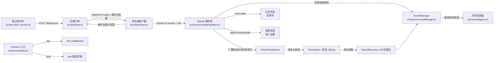
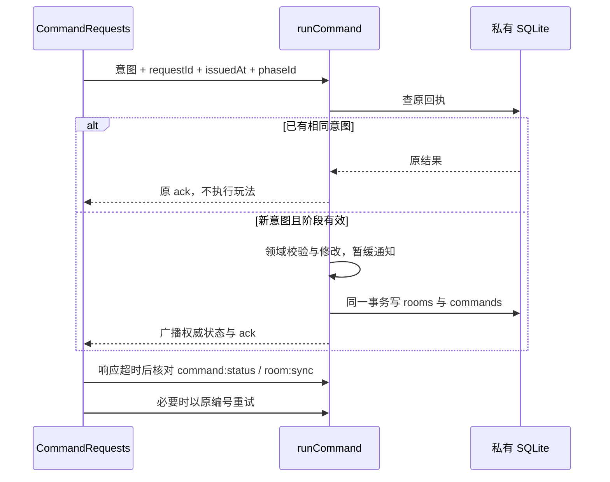
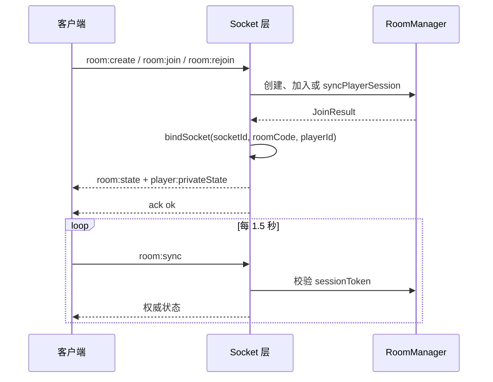
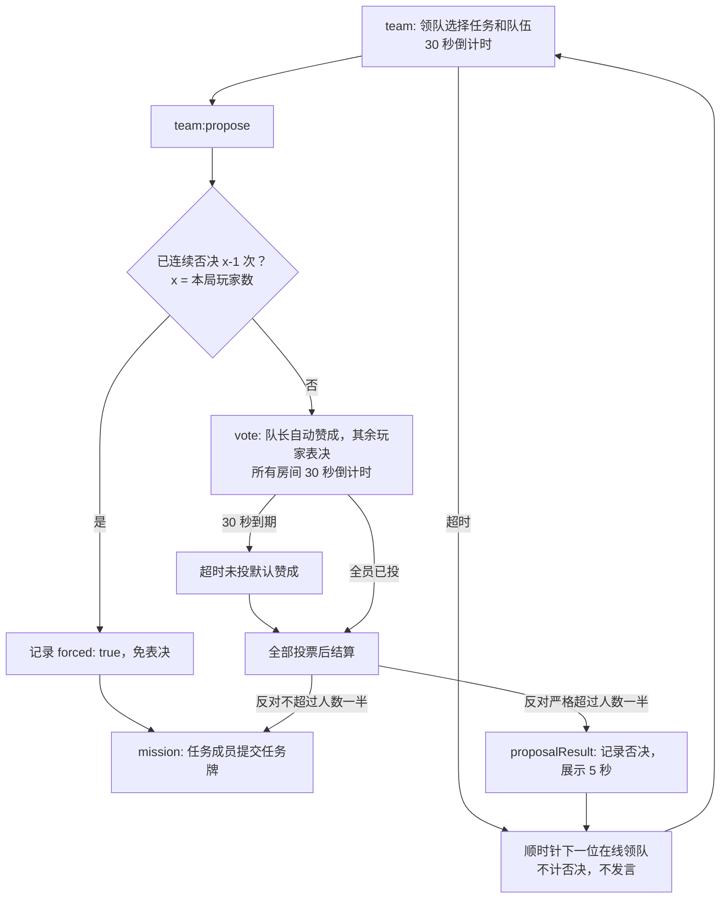
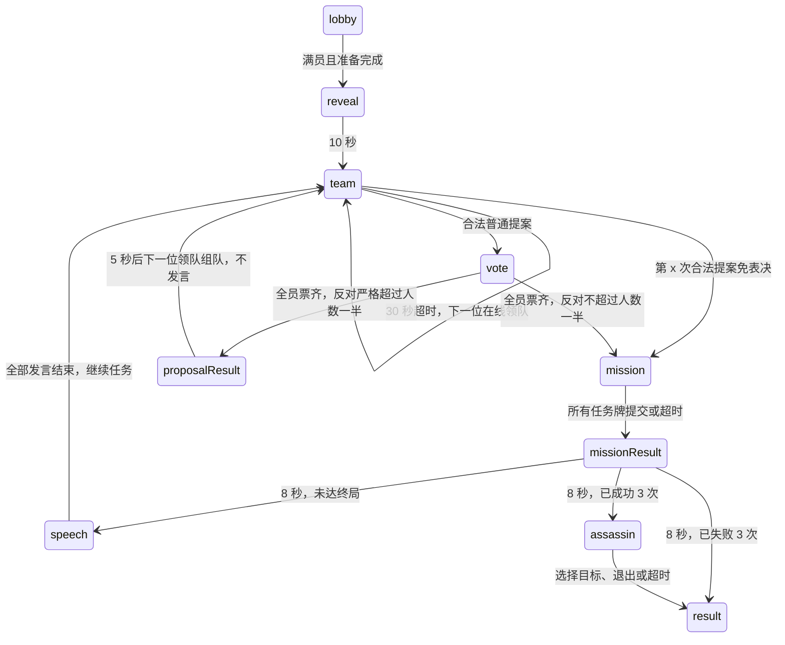
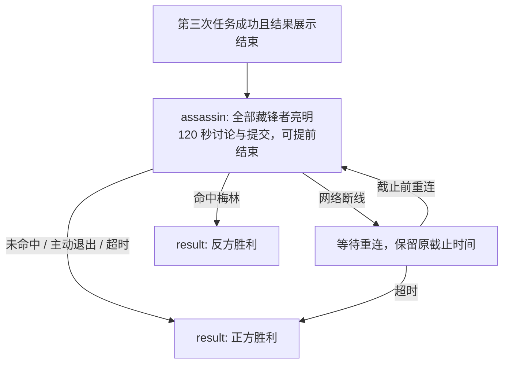
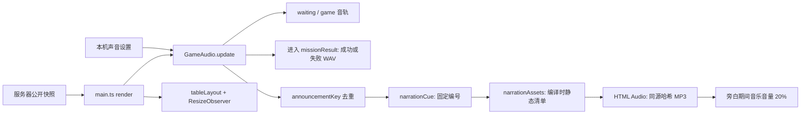
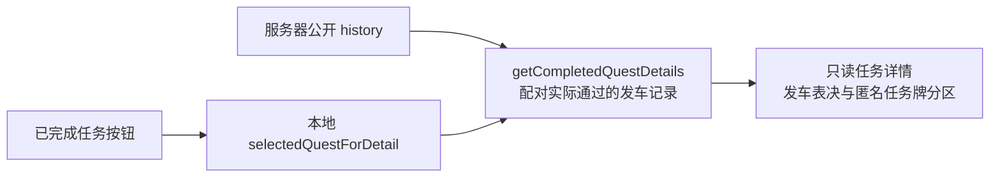
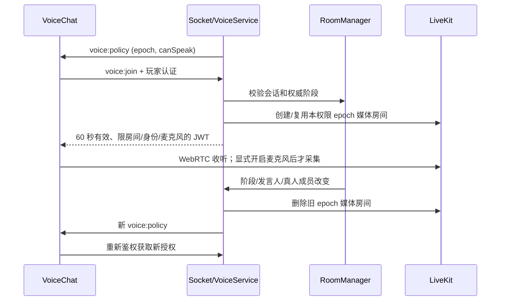

# Avalon 架构说明

本文档面向后续维护者，说明多人阿瓦隆 Web App 的架构、状态流、核心规则、代码规范和后续迭代入口。支持 LAN 与受控公网模式；部署配置见 [部署指南](../deployment/README.md)，实际网络与终端边界见 [网络支持](../user-guide/networking.md)，信任边界见[安全设计](security.md)。

## 目录边界

根 README 是公开项目入口，只介绍产品、启动和常用文档。`docs/user-guide` 面向玩家，`docs/development` 面向贡献者，`docs/deployment` 面向运维；媒体制作、许可与公开文件摘要放在 `docs/media`，展示图片放在 `docs/images`。内部审计过程、阶段验收和同类比较保存在忽略的本机目录，不参与构建或公共 CI。统一导航见 [文档索引](../README.md)。

`scripts` 按 `build`、`deploy`、`media`、`checks`、`verify` 分组，npm 命令名称保持稳定。命令从项目根目录执行；需要定位资源的工具从自身位置解析根目录，构建和恢复验证则使用工作目录或显式输出参数。输出仍在原本的 `dist`、`dist-server`、`.media` 或显式目标目录，不能因为移动而改写脚本目录中的新副本。Docker 与验证工具使用同一组入口；本地文档链接纳入 `npm run check` 与 CI。

此次整理不改变 `src/client`、`src/server`、`src/shared` 的依赖方向、协议或数据库版本。单测继续与模块相邻，浏览器测试继续集中在 `tests/e2e`。维护资料不复制进产品首页，也不通过删除检查来隐藏发布条件。

## 1. 总体架构

游戏状态由单进程 Node 服务权威管理，SQLite 保存恢复快照；可选实时语音由独立 LiveKit SFU 转发：

- 一台电脑运行 Node 服务，默认监听 `0.0.0.0:3000`。
- 房主在浏览器创建房间，其他玩家在同一 Wi-Fi 下访问 LAN 地址加入。
- Express 同时提供 HTTP 服务、开发模式 Vite middleware 或生产静态资源托管。
- Socket.IO 负责客户端事件、ack、房间广播和私密状态推送。
- `RoomManager` 是唯一权威状态源，客户端只提交用户意图。
- 暗号入口独立于玩家房间会话：Express 校验入场 Cookie 后才返回游戏文档，Socket.IO 握手和后续事件也检查入场授权。
- 可迁移公网模式使用共享 Caddy HTTPS → Node，不再依赖 Nginx。Compose 默认只有应用并映射回环端口，现有 Caddy 导入站点配置；没有网关才启用可选 `standalone` profile。固定代理信任，配置不完整时拒绝启动，不需要在开发电脑部署公网。
- `VoiceService` 从权威游戏阶段派生发布权限，LiveKit 承载 WebRTC 音频，不通过游戏 Socket 发送音频文件。

内存中的 `RoomManager` 是运行时事实源，每次可见状态变更先写入私有 SQLite，再广播/成功响应。重启从版本化快照恢复，停机期间暂停游戏倒计时，并给原在线玩家最多 60 秒重连。仍为单写者，不是分布式房间服务。前后端契约或服务器规则变更需一起部署；`npm run build` 构建 `dist/` 与 `dist-server/`，生产入口为 `node dist-server/server/index.js`。不能直接运行仅安装生产依赖的 TypeScript 源码。先在独立工作目录、端口和数据库路径验证，不覆盖在线静态资源或共用数据库。



关键入口：

- `src/server/index.ts`：创建 Express、HTTP server、Socket.IO，开发模式挂载 Vite，生产模式托管 `dist`。
- `src/server/config.ts`：解析 LAN/public 配置，验证 HTTPS 来源、强暗号、可信代理和媒体凭证。
- `src/server/security.ts`：有界令牌桶、连接配额、代理/IP/Origin 策略与全部客户端事件的严格 Zod schema。
- `src/server/voice.ts`：签发短期媒体授权、按权限 epoch 隔离媒体房间、启动预检与媒体清理。
- `src/server/accessGate.ts`：暗号校验、IP 错误次数限制、签名入场 Cookie、页面和 Socket 授权；不参与房间身份或游戏胜负。
- `access.html` / `src/client/access.ts`：独立入场文档及表单，不加载游戏入口、不读取玩家会话、不保存暗号。Vite 多入口同时构建 `index.html` 与 `access.html`。
- `src/server/socketHandlers.ts`：绑定 Socket.IO 事件、管理 socket/player 映射、广播状态、处理大厅断线宽限。
- `src/server/roomManager.ts`：维护权威状态机和领域校验，编排阶段推进；不承担模板渲染或 SQLite 实现。
- `src/server/roomTypes.ts`：运行时房间、玩家与计时器类型。
- `src/server/roomViews.ts`：纯公开/私密状态投影，由服务端决定隐私边界和动作权限。
- `src/server/roomAI.ts`：AI 调度与旧回调取消，通过领域操作回调行动，不绕过权限修改状态。
- `src/server/roomSnapshot.ts`：v2 私有快照、v1 迁移、Map 序列化与严格结构/成员/阶段校验；不保存运行时句柄与旧部署 URL。
- `src/server/roomStore.ts`：内置 SQLite、事务、独占写者锁、门禁密钥、快照容量和数据库版本边界。
- `src/server/roomPersistence.ts`：恢复入口、提交/检查点/关闭边界；写入失败时暂停游戏。
- `src/server/roomRecovery.ts`：重连宽限、原玩家到齐检测、暂停期间剩余时间，不负责业务胜负判定。
- `src/shared/game.ts`：共享类型、角色定义、人数表、任务人数、失败牌规则和私密信息推导。
- `src/client/main.ts`：状态订阅、交互编排、草稿、事件绑定和去重，调用视图而非内嵌全部页面模板。
- `src/client/views/`：入口、圆桌/任务、身份、操作、历史/任务详情、规则/收藏馆和房间弹窗的纯渲染函数；显式接收 `GameViewContext` 或窄化参数，不访问 Socket、localStorage 或修改权威状态。
- `src/client/viewHelpers.ts` / `roleCatalog.ts`：共享转义/展示计算、角色资料与规则展示数据，避免视图复制领域规则。
- `src/shared/protocol.ts`：协议版本、命令白名单、阶段作用域、回执与校时类型。
- `src/server/commandReceipt.ts`：私有回执 schema、有效期/容量边界；`socketHandlers.runCommand()` 编排校验、重放、原子提交和提交后通知。
- `src/client/commandRequests.ts`：冻结用户意图、相同编号重试、迟到响应/回执核对、断线等待及超期处理。
- `src/client/serverClock.ts`：基于 RTT 样本和单调时钟估算服务器时间；不修改服务器计时器。
- `src/client/domRenderer.ts`：morphdom 节点差异更新、稳定键和每轮监听清理，不包含玩法逻辑。
- `src/client/dialogMotion.ts`：按展示弹窗标题跟踪入场时间；新打开与切换内容播放动画，同标题重绘不重播，关闭后重开重新播放。不参与任何服务端阶段推进。
- `src/client/table-theme.css`：当前启用的圆桌主题、全部页面及弹窗样式、响应式布局和结果动画。`styles.css` 为此前主题，当前入口不再加载。
- `src/client/portraits.ts`：人物图集坐标及角色/公共座位映射；公共座位映射只依赖 `position`。
- `src/client/roleLabels.ts`：角色展示统一加『』；完整角色名优先匹配且重复格式化不重复加标签。私密信息和胜利原因按现有服务端文案的固定前后缀保护中间的玩家昵称，随后由模板转义 HTML。若服务端修改这两类文案，须同步调整此模块及重名昵称测试。共享名称、卡片导航标识、权限和语音数据保持原值。
- `src/client/audio.ts`：本地音乐生命周期、公开阶段播报、去重、音量和偏好存储。
- `src/client/audioControls.ts`：独立挂载的声音设置面板；调整音量不触发整页重绘。
- `src/client/voice.ts`：懒加载 LiveKit SDK、独立语音面板、收听/麦克风/音量、阶段重连和声音轨道清理。
- `src/shared/voice.ts`：不包含身份与服务端密钥的语音契约。
- `src/client/tableLayout.ts`：纯函数计算正圆座位坐标和容纳当前人数的最小桌面尺寸。
- `src/client/icons.ts`：按需导入 Lucide 图标并生成标记。

## 2. 权威状态模型

### 入场门禁

`index.ts` 从仓库根目录 `.env` 加载 `GAME_ACCESS_CODE`（已有进程环境变量优先），未配置时启动失败，不提供公开默认暗号。`.env` 已忽略，`.env.example` 只含占位符。Node.js 最低版本为 22.13，以免为 `node:sqlite` 增加运行时实验开关；使用受支持且已打安全补丁的版本。LAN 可自动读取 `.media/voice.env`，public 不加载该测试配置。

`POST /api/access` 接收 `{ code: string }`，JSON 上限 1KB、禁止压缩请求体、暗号最长 128 字符，哈希后恒定时间比较。同一 IP 一分钟内最多 5 次失败，后续返回 429 / `Retry-After`；成功清除旧失败计数，表最多记录 4096 个地址。LAN 忽略转发头，public 仅信任 `TRUST_PROXY_CIDRS` 中实际代理的 IP 与 HTTPS 转发头。相同 NAT 玩家共享限流，多实例需要共享配额存储。

成功签发随机 nonce、截止时间及 HMAC 签名组成的 `awalong-access` Cookie，有效期 12 小时，`HttpOnly / SameSite=Strict / Path=/`；直接 HTTPS 或已验证的 HTTPS 代理请求会加 `Secure`。32 字节随机签名密钥及暗号指纹保存在私有 SQLite metadata；相同数据库和暗号重启不使 Cookie 失效，修改暗号会轮换密钥。测试不传入持久化密钥时仍是进程级临时 Cookie。禁止将代理信任范围设为 `true` 或全网 CIDR。

页面导航按 Cookie 返回游戏页或暗号页，文档使用 `no-store / Vary: Cookie`。图片、CSS 和公开脚本不受门禁保护，不能把它们当秘密。Socket.IO middleware 同时校验 Cookie 与浏览器 Origin，拒绝匿名或跨源游戏连接，返回 `ACCESS_REQUIRED`；已连接会话到期由服务端断开，每次事件也重新验签。客户端收到失效提示后重新加载服务器入口，保留原玩家重连凭证。入场页成功后保留邀请参数，刷新获取游戏文档；网络错误或错误口令保留输入，不在前端比对暗号。

静态资源未命中的最终 HTML 兜底必须使用 `protectPages(renderAccess, true)` 再鉴权，不能因请求有 `.js/.css` 等扩展名就返回游戏 HTML。开发 Vite 采用 `appType: custom`，HTML 由 Express 统一验证后再 `transformIndexHtml()`，不允许 Vite 自动 SPA 回退绕过边界。

共享门禁用于邀约游戏，不是账号体系；public 要求至少 16 字符的私有暗号与 HTTPS。Engine.IO `allowRequest` 在建连前检查门禁/来源并预占连接配额，Socket 层仍逐事件复验授权。门禁不能替代玩家 token、socket 绑定及 `RoomManager` 动作权限。手工 QA 脚本用自己的入场 Cookie 与玩家会话，不输出凭证。

服务端 `RoomInternal` 是房间事实来源。重要字段：

- `code`：房间码。
- `hostId`：房主玩家 ID。
- `targetPlayerCount`：本局目标人数，5-10。
- `phase`：`lobby | reveal | team | vote | proposalResult | mission | missionResult | speech | assassin | result`。
- `players`：玩家列表，包含连接状态、准备状态、位置、身份、AI 标记和 session token。
- `leaderIndex`：当前领队在 `players` 中的位置；发言阶段已指向下一次提案的领队，上一轮发车人保存在历史中。
- `questIndex`：当前选择或默认要执行的任务序号，0-4。
- `proposal`：已提交并进入投票/任务阶段的正式队伍。
- `votes`：发车表决记录。
- `missionVotes`：任务牌提交记录。
- `history`：公开历史，包含被否决的提案和已完成任务。
- `winner / winnerReason`：结算结果。
- `timer`：服务端当前阶段计时，包含类型、标签、截止时间、总时长和可选发言人；揭晓、结果、发言和刺杀在 AI 房间也适用。
- `speechOrder / speechIndex / speechNextLeaderIndex`：任务后发言的顺序、当前位置和已确定的下一位领队；否决后不发言。在线真人与 AI 都在顺序中。

公开状态 `PublicRoomState` 会广播给所有房间成员。普通阶段 `revealedRoles` 为空；`assassin` 阶段仅填充全部藏锋者（含奥伯伦）的身份，不能包含梅林或其他守誓者；`result` 阶段才填充全员身份。`players` 本身始终不带秘密角色字段。

公开状态也包含 `timer` 和仅含公开玩家 ID 的 `speechOrder` 副本。客户端用它们渲染倒计时、身份/结果展示和发言名单；揭晓结束、结果结束、组队超时轮转、超时默认投票/任务牌和发言推进仍由 `RoomManager` 权威执行。重连保留原截止时间，不能让本地动画完成回调决定下一阶段。`timer.kind` 新增 `team`，前后端必须一起部署；旧服务器不会执行组队计时和新版多数反对规则。

私密状态 `PrivatePlayerState` 只发给对应玩家，包含角色、阵营、角色说明、私密信息和当前可执行动作：

`servantVariant: "male" | "female" | null` 是卡面外观，不是新角色。它只在开局为忠臣抽取，其余角色及大厅为 `null`；保存在 `PlayerInternal`，只向本人发送。`PublicRoomState.players` 绝不包含该字段，只有最终 `revealedRoles` 才公开原始分配。重连和状态读取不重新抽取，重开清空。客户端 `rolePortraitCell(role, servantVariant)` 不按 ID 或本地随机生成；缺少字段时仅回退到默认男性卡面。前后端需一起部署并刷新旧客户端。

`PublicRoomState.servantCounts: { male: number; female: number } | null` 仅公布整局忠臣男女数量。`roomViews.ts` 统计内部已分配角色，开局后包含离线玩家，返回新的汇总对象；大厅和重开后为 `null`。它不携带任何玩家 ID、座位或个体变体，不能将汇总塞进 `players`。客户端分别渲染男、女角色资料卡，含零数量；未分配或旧服务端缺少字段时显示“待分配”，不能按期望概率编造人数。新增契约需同时部署服务端和客户端；恢复快照保留原男女卡面及汇总，不重新抽取。

- `canPropose`
- `canVote`
- `canMission`
- `canFailMission`
- `canAssassinate`

## 3. Socket.IO 事件契约

所有改变状态的客户端事件都带 ack：

```ts
type Ack = {
  ok: boolean;
  error?: string;
  code?: string;
  roomCode?: string;
  playerId?: string;
  sessionToken?: string;
};
```

客户端发送：

下面列表仅列业务字段。所有改变状态的命令另加 `{ requestId, issuedAt }`；除创建、加入、离开和解散外，还必须带当前公开 `phaseId`。`requestId` 为 `r_` 加 32 位随机十六进制，`issuedAt` 是客户端校准后的服务器毫秒时间，允许最多向未来偏差 30 秒，重试窗口 10 分钟。原始数组和时间戳在重试时不得修改。`room:rejoin / room:sync / voice:join` 是查询/授权，不加命令字段。

- `room:create`：`{ name, targetPlayerCount }`
- `room:join`：`{ roomCode, name }`
- `room:rejoin`：`{ roomCode, playerId, sessionToken }`
- `room:sync`：`{ roomCode, playerId, sessionToken }`
- `room:addAI`：`{ roomCode, playerId, sessionToken, count }`
- `room:setPlayerCount`：`{ roomCode, playerId, sessionToken, targetPlayerCount }`
- `player:setReady`：`{ roomCode, playerId, sessionToken, ready }`
- `room:start`
- `player:kick`：`{ targetId }`
- `room:dissolve`
- `room:restart`
- `room:leave`
- `team:propose`：`{ team: string[], questIndex?: number }`
- `vote:submit`：`{ approved: boolean }`
- `mission:submit`：`{ failed: boolean }`
- `assassin:choose`：`{ targetId }`
- `speech:end`：结束本人的当前发言。
- `voice:join`：完整房间认证，ack 为 `{ ok: true, access: VoiceAccess }`；只签发媒体授权，不改变游戏状态。
- `clock:sync`：`{}`，ack 含 `protocolVersion / serverReceivedAt / serverSentAt`；经过入场门禁与独立速率限制，不要求已有玩家身份。
- `command:status`：`{ event, requestId, sessionToken? }`，ack 为 `{ ok, result: Ack | null }`；创建/加入按同一入场 Cookie 哈希定位，其余命令按原 token 哈希定位，只读取已有结果，不执行或延长请求。

服务端推送：

- `room:state`：公开房间状态。
- `player:privateState`：本人私密状态。
- `voice:policy`：`{ configured, roomCode, epoch, canSpeak }`，发给对应玩家，不携带角色或 JWT；epoch 变化时客户端重新请求授权。
- `server:hello`：连接时发送协议版本；版本不匹配要求刷新，旧版无命令字段的请求返回 `PROTOCOL_MISMATCH`。
- `room:removed`：被房主移出房间。
- `room:dissolved`：房间被房主解散。

设计要求：

- 新增事件必须走 ack。
- ack 失败时客户端应提示错误，不得本地写入权威状态。
- 状态改变后由 `publish(roomCode)` 广播统一状态。
- 客户端关键事件成功后会追加一次 `room:sync` 作为补偿校验。

### 请求一致性

`phaseId` 是操作窗口的随机身份，不是每张票后的状态版本。开启新的阶段计时器（包括换队长/发言人）、重开大厅和最终结算时更新；同阶段其他玩家投票不会使其失效。服务端先查原请求回执，再检查当前阶段，因此上一轮成功票的重试可返回成功，但不会算成新一轮投票；未执行过且携带旧阶段编号的请求返回 `STALE_PHASE`。

回执包含事件与规范化负载的哈希；同编号改内容返回 `REQUEST_CONFLICT`。创建/加入绑定入场 Cookie 哈希，其他命令绑定玩家 token 哈希，不允许只猜一个请求编号获取他人会话。回执每主体最多 256 条、全局最多 16384 条，过期清理；达到容量拒绝新意图，不把配额不足当作磁盘故障暂停所有房间。回执包含私密会话信息，不能公开或记录到访问日志。



超时不能被当成确定失败。客户端先发核对查询，并最多连续尝试 3 次同编号命令；仍无法确认则保留原请求等待重连/后续核对，迟到 ack 仍可完成它。请求超期不自动生成新意图；旧阶段已无法继续时提示以当前对局状态为准。浏览器刷新会丢弃内存中的未确认意图，但已有玩家身份仍走原重连流程；不声称“永久恰好一次”或跨门禁会话重放。

## 4. 生命周期与状态流

### 4.1 进房、重连与同步



客户端保存 `{ roomCode, playerId, sessionToken, name }` 到 `localStorage`。刷新后用 `room:rejoin` 恢复连接。

自动重连在服务器明确否定身份时清理失效会话、状态和草稿；单纯请求超时不会删除原身份。`UNCONFIRMED` 只表示未确认，继续核对；成功重连恢复操作控件并重试仍有效的原请求。首页手动重连也不在没有成功响应时伪造已加入。

客户端会周期性发送 `room:sync`，但不会每次都重绘页面。`src/client/main.ts` 会序列化最新 `room:state` 和 `player:privateState`，只有内容变化时才调用 `render()`，从而保持前后端通信一致但避免页面持续刷新。

模板仍生成目标 HTML，但 `domRenderer.patchHtml()` 使用 morphdom 对现有节点做差异更新，不再给 `#app.innerHTML` 整体赋值。圆桌/座位/历史/面板和同内容弹窗有稳定键，命令按钮按语义区分，避免把旧阶段焦点带到另一种操作。同一节点的滚动和光标由浏览器保留；不同弹窗创建新节点，不沿用旧滚动位置。每次绑定前用 AbortController 移除上次监听，声音/语音按钮也接收同一 signal，防止一个点击触发多次操作。它不是服务器增量协议，仍保留全量快照与序列化去重。

`ServerClock` 用 `clock:sync` 的往返耗时估计服务器时间，优先近期低延迟样本，之后用 `performance.now()` 推进，避免设备 `Date.now()` 跳变。重连/回到前台清理旧采样选择，再校准；常规每 30 秒校准。倒计时、身份揭晓及旁白剩余时长统一使用这一时间源，游戏推进仍只看服务端计时器。它是网络估算，不保证毫秒级跨设备同步。

界面局部状态不进入房间广播：入口输入与模式、身份隐藏开关、角色收藏馆筛选、待确认刺杀目标和弹窗状态只存在本机。刺杀提交仍走 `assassin:choose`，离开确认仍走 `room:leave`；只有 ack 成功后清理本地会话。

### 4.2 大厅

大厅规则：

- 创建和加入都要求非空名字。
- 同房间不能重名。
- 当前人数达到 `targetPlayerCount` 后拒绝加入。
- 房主可调整目标人数，但不能低于当前人数。
- 房主不需要准备，服务端也拒绝房主准备事件。
- 非房主可准备/取消准备。
- 开始游戏要求当前人数等于目标人数、全员在线、所有非房主已准备。
- 大厅玩家显式离开会释放座位；房主离开会把房主身份转给顺时针下一位玩家。
- 房主可踢人或解散房间。

准备状态不做乐观更新。客户端点击准备后只发送 `player:setReady`，等待服务端 `room:state` 后再显示结果。

### 4.3 断线处理

- socket `disconnect` 时，服务端先标记玩家 `connected=false` 并广播。
- 大厅玩家进入 3 秒宽限期；宽限内重连或 `room:sync` 会取消清理。
- 宽限后仍未绑定 socket，服务端调用 `removeDisconnectedLobbyPlayer()` 移除玩家并广播。
- 游戏中断线不移除玩家，按阶段自动处理：
  - 领队在组队阶段断线：跳到下一个在线玩家。
  - 投票阶段断线且尚未投票：默认赞成。
  - 任务阶段任务成员断线且尚未提交：默认成功牌。
  - 发言阶段当前发言人断线：从发言队列移除并推进到下一位发言人。
  - 刺杀阶段断线：保留当前 120 秒截止时间，允许在剩余时间内重连；超时未选择目标则守誓者获胜。
- `proposeTeam()` 进入 `vote`、发车表决通过进入 `mission` 时都会调用 `resolveOfflinePlayerActions()`。这会补齐此前已经断线的玩家动作，而不只处理当前阶段刚发生的断线；已提交的票或任务牌不会被覆盖。
- `room:leave`、socket `disconnect` 和重新绑定身份导致旧玩家断线后，Socket 层广播状态并调用 `simulateAI()`，让接替领队的 AI 继续行动。
- 刺客在 `assassin` 阶段主动 `room:leave` 视为放弃刺杀，立即结算正方胜利。网络断线与主动退出分开处理，避免一次短暂断线立即判负。

### 4.4 持久化与进程恢复

`RoomStore` 使用 Node 内置 `node:sqlite`，没有引入 ORM 或外部数据库服务。`rooms` 表保存 v2 JSON 快照，`metadata` 保存检查点及门禁密钥，`commands` 保存有界过期回执。v1 快照在启动事务中验证并迁移，生成阶段编号而不重新发牌；未知新版/损坏内容拒绝启动。Map 显式转为条目数组，定时器/AI 句柄、socket ID 和旧 `localUrls` 不落盘；启动使用当前配置重新生成分享地址。

选择单文件 SQLite 是为了保持自托管安装简单，同时利用事务和崩溃恢复；不是为横向扩展准备的共享数据库。`locking_mode=EXCLUSIVE` 拒绝两个进程同时使用同一文件，`synchronous=FULL` 与回滚日志保障事务边界。不要放在网络共享目录或挂到多个副本。快照上限为 200 个房间、单条 256KiB，数据库约 128MiB（默认 4KiB 页），并非无限历史存储。

命令提交顺序为领域校验/修改 → `RoomPersistence.commit()` 同一事务保存房间与结果回执 → 踢人/离房等通知与公开/私密广播 → ack。定时器与 AI 的自主推进仍用 `save()`。相同快照不重复写盘，1.5 秒 `room:sync` 只读取和校验；另有 1 秒检查点用于硬退出时推算暂停点。保存/回执/检查点失败会停止业务计时器、拒绝后续命令并使 `/healthz` 返回 503；数据库提交失败不能先发成功通知。重启以最后已提交状态为准。

恢复流程：

1. 启动先验证数据库版本、JSON 结构、成员引用和阶段/计时器关系；损坏或未知版本拒绝启动，不静默清空。超过全离线 10 分钟或结算 30 分钟 TTL 的房间删除。
2. 真人全部标记离线，保存原计时器剩余毫秒数，暂停游戏与 AI。公开 `recovery: { deadline, connected, expected }`，`timer.kind="recovery"` 只用于界面；私密动作权限和语音发布关闭，旁白不补播旧结果。
3. 原在线真人凭原 `sessionToken` 重连，全部到齐则提前恢复；否则最多等待 60 秒。再次崩溃不会重置已保存的宽限截止时间。允许本人离开/房主解散，不能借恢复窗口提交游戏动作。
4. 按保存的剩余时间恢复原阶段，再按已有离线默认规则处理未回来的玩家；大厅缺席成员清理，空房间删除。任务牌、投票、卡面、历史、比分、发言人和刺杀讨论都保留，不重复发牌或结算。

停机时间不消耗游戏计时，但仍计入离线/结算 TTL；硬退出因每秒检查点可能有约 1 秒计时误差。正常关闭先保存并刷新检查点，再取消运行时计时器。快照不是公开状态，包含隐藏角色、任务牌和凭证；默认 `data/` 与数据库被 Git/Docker build context 忽略，不可静态托管，备份也须私有。运维步骤和首次升级/回滚限制见 `docs/deployment/README.md`。

## 5. 发车、投票与任务流程

任务人数的唯一业务配置为共享 `TEAM_SIZES`；五人局使用 `2、2、3、3、3`（交换任务二、三的原人数），6–10 人不变。服务端 `proposeTeam()`、前端任务栏、选队控件和规则任务表统一调用 `getTeamSize()`；失败阈值仍通过 `getRequiredFails()` 获取。修改此配置需同时构建客户端并重启服务端，不能只部署前端。

### 5.1 选任务与组队

通过人数、在线、准备与房主权限校验后，服务器用 `crypto.randomInt(players.length)` 从全部座位等概率抽取首位领队，房主与 AI 都可能被选中；不受身份、昵称或玩家 ID 决定。随后为忠臣独立用 `crypto.randomInt(2)` 抽取男女卡面，各 50%。分配后进入 `reveal`，使用共享常量 `ROLE_REVEAL_DURATION_MS = 10_000`。所有人的组队、投票、任务权限均关闭，计时结束才进入 `team`；AI 在此阶段也不行动，随机 AI 首发会在揭晓结束后自动组队。重连不重新抽取首发队长或卡面；之后的顺时针轮换与发言规则不变。

`getRoleDeck()` 是发牌、公开身份配置和规则页的唯一牌组来源。5、6 人的反方为刺客和莫甘娜；7、8 人增加莫德雷德；9、10 人再增加奥伯伦，正方仍为梅林、派西维尔及补足人数的忠臣。5–10 人不包含 `minion`，共享定义、图集和收藏馆资料保留它作为历史/扩展资料，不用于当前人数的发牌。

领队在 `team` 阶段可以选择一个未完成任务，再选择上车玩家。这个选择在提交前是本地草稿：

- `pendingQuestIndex`：领队本地选择的任务。
- `pendingTeam`：领队本地选择的队伍。
- 圆桌卡和桌下头像/姓名按钮统一调用 `toggleTeamPlayer()`；检查公开阶段、领队 ID、私密 `canPropose`、提交中状态、在线状态和人数上限。桌下按钮用 `aria-pressed` 表示选中，不额外生成一份草稿。
- `reconcilePendingTeam()` 会避免周期性 `room:sync` 覆盖领队草稿。
- 其他玩家不会看到领队点击选择的过程。
- 只有提交 `team:propose` 后，服务端才写入 `room.questIndex` 和 `room.proposal`，进入 `vote` 或满足否决上限时直接进入 `mission`。

服务端校验：

- 只有当前领队可以提交队伍。
- 显式传入的 `questIndex` 必须是 0-4 的整数；省略时使用当前任务。
- 已完成任务不能再次选择。
- 队伍人数必须匹配所选任务人数。
- 队伍不能包含断线玩家。

### 5.2 发车表决

发车表决是对“是否同意这辆车和这批人上车”的投票：

- 普通提案进入 `vote` 时，服务器先向 `votes` 写入领队的 `true`；领队自动赞成且不能重复提交或修改。
- 除领队外的玩家都可投赞成或反对，不受阵营限制。
- 每名可投票玩家只能投一次。
- 所有房间进入 `vote` 时启动 30 秒服务端倒计时，含 AI 单机局；倒计时只由公开 `timer` 渲染。
- 倒计时结束时，未投票玩家默认赞成。
- 所有可投票玩家都投完后才结算。
- “全员”包含领队自动赞成票，票数齐全才结算；即使已达到多数反对也继续等待其余玩家提交或超时，确保公开名单完整。
- 只有反对票严格大于 `room.players.length / 2` 才否决；门槛通过共享函数 `getProposalRejectionThreshold(n) = floor(n / 2) + 1` 统一判定与规则页。5–10 人分别需要 `3、4、4、5、5、6` 张反对票。未达到门槛即进入 `mission`，偶数局平票通过。
- 否决时写入 `result: "fail"` 历史、递增拒绝次数、保留所选任务，进入 `proposalResult` 展示 5 秒，随后顺时针换下一位在线领队，直接进入 `team`，不进入 `speech`。
- 已经投出的反对票不会被断线或超时默认赞成覆盖；人数分母是开局实际人数，包含 AI 和中途离线玩家。
- 上限 `x = room.players.length`，即本局开局实际人数，包含 AI 和中途离线玩家。连续否决 `x-1` 次后，第 `x` 次合法提案直接进入 `mission`，否决次数不构成胜负条件。
- 共享函数 `isForcedLaunch(rejectCount, playerCount)` 统一后端校验、前端提示和播报。强制发车仍校验当前队长、未完成任务、人数和玩家在线状态；例如 7 人局前六次可否决，第七次免表决。
- 强制发车历史使用 `type: "vote"`、`forced: true` 和 `result: "success"`，投票计数为 0、明细为空；客户端显示“强制发车/免表决”，不伪造赞成票或反对比例。
- 普通通过和强制发车统一由 `startMission()` 启动任务，保持任务权限、30 秒截止时间及断线默认成功行为。任务结算后清零否决计数。
- 全部可投票玩家提交后立即判定，不等待 30 秒结束；AI 自动投票可能让阶段提前结束，不能因此省略计时器。

发车失败展示使用 `PROPOSAL_REJECTION_DURATION_MS = 5_000` 和公开 `timer.kind = "proposalResult"`。客户端 `renderProposalOutcome()` 展示最新否决记录、公开队员头像、票数及赞成/反对名单，不能操作投票、组队或提前结束展示。结果截止时间由服务器保留，重连不重置；重新开始、解散和关闭运行时清理展示定时器。CSS 使用已过去时间设置负动画延迟，重连或其他状态重绘不把印章动画从头开始。此阶段不调度 AI，避免 AI 动作覆盖结果。

`voteDetails` 只在全员表决完成或超时补齐默认票后加入公开历史，包含所有玩家的 `{ playerId, approved }`，包括队长自动赞成票，不会提前广播其他玩家的选择。`voteSubmitted` 和前端进度也包含队长，分母为全体人数。`renderVoteDetails()` 复用在失败展示及历史详情中，按公开座次显示中性头像与转义后的原昵称；队长归入赞成名单，并注明自动赞成。`expandedVoteRecords` 只保存本地历史详情展开状态，同步/阶段变化不清空，退出房间或回到大厅时清空。任务执行卡的个人选择仍不公开；强制发车明细为空且不显示伪造名单。

组队通过 `startTeamPhase()` 统一进入，公开 `timer.kind = "team"`，`TEAM_SELECTION_DURATION_MS = 30_000`。开局揭晓结束、否决结果结束、任务后全员发言结束都会获得完整的 30 秒。超时由服务器顺时针更换下一位在线领队并重新计时，不提交本地草稿、不写入投票历史、不增加否决次数。队长断线时也立即轮转并重新计时。同步或重连到同一轮不会重置截止时间，合法提案会替换组队计时器；重开、解散和关闭运行时清理旧回调。



### 5.3 任务执行与结算动画

任务执行阶段：

- 只有 `proposal` 中的任务成员可以提交任务牌。
- 每名任务成员只能提交一次。
- 正方任务成员只能提交成功牌。
- 反方任务成员可提交成功或失败牌。
- 所有房间进入 `mission` 时启动 30 秒服务端倒计时，包含 AI 房间；全体任务成员提交后立即判定。
- 倒计时结束时，未提交任务牌的队员默认提交成功牌。
- 7 人及以上第 4 个任务需要 2 张失败牌才算失败，其余任务 1 张失败牌即失败。

任务完成后服务端写入 `history`、更新分数、清空提案和提交列表，然后进入 `missionResult`，使用 `MISSION_RESULT_DURATION_MS = 8_000`。所有客户端通过 `renderMissionOutcome()` 展示最新任务的匿名牌汇总、队伍和累计分数。牌面仅按成功/失败总数排列，顺序不对应队员，不推断提交人。

结果计时结束后按比分分流：失败达到三次直接 `result`，成功达到三次直接 `assassin`，其余才 `speech`。保留 8 秒展示但不安排终局发言；判定只在服务端结果阶段截止时执行，客户端动画不决定阶段。



### 5.4 领队轮转与全员发言

提案被否决时先进入 5 秒 `proposalResult`，再直接进入下一位领队的 `team`；提案通过或强制发车后完成未达终局的任务，等待 8 秒结果展示后进入 `speech`；达到三次成功则进入刺杀阶段并开始两分钟讨论与目标选择，三次失败则直接结算：

- 否决与组队超时通过 `advanceLeader()` 直接轮转；任务成功或失败都通过 `findNextLeaderIndex()` 选本次领队顺时针下一位在线玩家接任，不会在任务后重复前进一次。
- 进入发言时即更新公开 `leaderId`，皇冠表示下一位领队。发言从该领队的下一位开始，顺时针排满一圈，该领队最后。例如 ABCDE 中 A 发车，B 接任，顺序为 CDEAB；E 发车则 A 接任，顺序为 BCDEA。
- 每位在线真人有 1 分钟服务端倒计时，当前发言人可用 `speech:end` 提前结束；其他人不能结束其发言，也不能在发言阶段组队。
- 在线 AI 也加入名单并显示当前发言状态，由 `simulateAI()` 在 3 秒后自动结束其发言，不占满真人的 1 分钟。
- 顺序通过公开 `speechOrder` 广播，当前人使用 `timer.speakerId`；客户端在顶部、圆桌和桌下名单展示进度，不能自行排序或推进。
- 发言计时结束后服务端推进到下一位；当前发言人断线也会跳过。
- 全部发言结束后保留已选领队；该领队期间离线则顺时针找下一位在线玩家。任务后选择下一个未完成任务；否决后直接组队时保留原任务。领队仍能另选任何未完成任务。
- 成功三次或失败三次不进入发言，结果展示后分别直接进入 `assassin` 或 `result`。
- 没有任何在线玩家时才使用 3 秒 `speech` 讨论兜底；全 AI 在线房间仍逐个展示 AI 发言。
- `RoomTimingOptions` 的 `revealDurationMs / resultDurationMs / proposalResultDurationMs` 允许测试缩短揭晓、任务结果与发车失败展示；生产默认分别为 10/8/5 秒，不暴露给 Socket 请求。单元测试使用虚拟时钟验证真实时长，Socket 集成测试使用短时长验证广播顺序。

顺序由服务器一次生成，客户端只显示公开队列。这避免多人设备自行计算造成差异，并保证任务结果期间的同步包不会重复换队长。断线移除队列成员；已跳过的玩家本轮重连不会补发言，下一轮重新加入。

### 5.5 刺杀与断线结算

第三次任务成功且本轮 8 秒结果展示结束后直接进入 `assassin`，使用共享 `ASSASSINATION_DURATION_MS = 120_000` 和 `timer.kind = "assassin"`。所有藏锋者（含奥伯伦）在 `revealedRoles` 中向全房间公开；客户端 `assassin-disclosure` 展示昵称、角色和资料卡，圆桌仍用中性头像但标明公开角色。梅林等守誓者角色继续保密。

讨论和提交共用 120 秒窗口，不增加额外发言轮或聊天协议。只有刺客有 `canAssassinate` 权限，可提前提交并立即结算：命中梅林则藏锋者胜利，否则守誓者胜利；本人或已公开藏锋者不是合法目标，前后端同时限制。真人超时未提交视为放弃。重连不重置截止时间，提交、主动退出、重开和解散均清理计时器。AI 刺客不再通过 1.5 秒模拟回调出手，而在窗口到期时从尚未公开的守誓者中选目标；离线 AI 同样按放弃处理。



## 6. 客户端渲染策略

客户端使用 vanilla TypeScript，页面渲染集中在 `main.ts`，角色标签、音频、声音控件和座位几何独立成模块：

- `renderLanding()`：未入房页面。
- `renderGame()`：游戏页面。
- `renderQuestTrack()`：任务轨。
- `renderRoundTable()`：圆桌与玩家卡。
- `renderActionPanel()`：阶段操作。
- `renderHistoryPanel()`：公开历史。
- `renderQuestDetailModal()` / `getCompletedQuestDetails()`：只读已完成任务的发车与任务汇总。
- `renderTimerBanner()` / `updateTimerDisplay()`：根据公开 `timer` 渲染顶部倒计时和最后 10 秒动画。

重要状态：

- `publicState`：公开状态，只来自服务端。
- `privateState`：本人私密状态，只来自服务端。
- `identity`：本地 session。
- `pendingTeam / pendingQuestIndex`：领队本地草稿，提交前不广播。
- `lastPublicStateJson / lastPrivateStateJson`：用于避免相同状态重复重绘。
- `lastGameResultKey`：避免重复或重连时重播最终胜负动画。任务结果页面由权威 `missionResult` 阶段驱动，不再用历史触发临时弹层。
- `dialogMotion`：本地展示弹窗的入场时间；同标题弹窗复用原节点，不重复设置动画。切换内容或关闭后重开创建新节点，必要时用负延迟衔接当前入场进度。
- `showSoloModal / soloPlayerCount`：单机人数选择；确认前不创建房间，修改人数不重播弹窗动画。
- `selectedQuestForDetail`：本地任务详情序号；同一对局快照更新时保留，关弹窗、退出或该任务记录在重开后不存在时清理。

实现原则：

- 不要在客户端决定游戏结果。
- 不要向 `PublicRoomState` 添加隐藏身份。
- 不要让周期同步覆盖用户正在编辑但尚未提交的本地草稿。
- 弹窗 toast 独立挂载到 `document.body`，不要触发整页重绘，否则会清空表单输入。
- 倒计时展示只能读取 `PublicRoomState.timer`，不要在客户端本地决定默认投票、默认任务牌或发言推进。

阵营展示名由共享 `FACTION_NAMES` 统一：`good -> 守誓者`、`evil -> 藏锋者`。协议、权限、角色定义和服务器规则仍保留 `good/evil` 及原始规则文案。模板中的阵营徽标直接使用映射；`roleLabels.ts` 在角色说明、私密知识固定前后缀及胜负原因中转换展示词，但不能转换昵称片段，尤其昵称本身为“正方/反方/梅林”时。`formatRoleKnowledge()` 同时识别原始与已格式化前缀，重复渲染保持幂等。语音同样使用展示名；通过的混合票记录不能仅因 `rejections > 0` 被播成否决，必须检查通过结果。

不确定的梅林指代统一显示『梅林？』，兼容服务器原始“梅林候选/候选人”与旧版已加标签的表达；它不是新身份，不改角色键或资料卡名称。私密名单格式化识别新旧前缀，只修改固定文案，不能把昵称中的相同词替换掉；重复格式化保持幂等。

### 6.1 音乐与公开播报

`GameAudio.update(publicState, playerId, connected)` 从服务器快照推导声音行为。`lobby`、未入房和 `result` 使用 `medieval-fair-loop.ogg`，其他阶段使用 `game-investigation-loop.ogg`（Unsolved Investigation，CC0 悬疑氛围循环）。两个音轨只在需要时创建，600ms 音量过渡后暂停非当前音轨；不会因周期同步重建音轨或重置播放进度。强制发车依据公开历史播报，不称作全员赞成。

规则任务表中的最低成功牌数量由 `getRequiredSuccesses(count, questIndex)` 推导：`队伍人数 - 失败所需张数 + 1`。例如 7 人局第四个任务四名队员，失败阈值为两张，因此三张成功牌即可成功；说明列仍展示失败判定规则。

播报由 `announcementKey()` 去重，只关注房间、阶段、领队、任务、正式队伍、否决次数、历史长度、当前发言人和胜负；个人提交列表、倒计时数值、玩家昵称和胜负原因不进入播报键。`narrationCue()` 仅选择固定编号，`narrationAssets.ts` 从编译时导入的静态清单查找同源 MP3。仅相邻快照中新增加的历史触发任务结果播报，首次加入、重连或中途开启旁白不补播结果。

正常投票、强制发车、普通任务结果、累计三次成功或失败分别选择不同录音。进入 `proposalResult` 播报发车失败，结果后直接组队；普通任务后进入发言，累计三次成功提示随后讨论与刺杀，三次失败提示胜负。发言开始和下一位发言使用短录音，具体玩家和顺序仍在界面显示，不再用 TTS 拼接昵称。

房主默认开启播报，其他玩家默认关闭，避免同一桌多台手机同时说话。音乐、游戏旁白、结果音效分别有开关与音量，设置仍保存到 `localStorage` 的 `awalong-audio`，兼容旧存档。首次点击/按键后解锁播放；旁白只要求 HTML Audio，不再依赖系统中文语音或 Web Speech。录音已包含选定的语速，不在播放器中再次减速；旁白音量可在播放中调整，不重启录音。

每次新旁白使用独立的非循环音轨，`playing` 事件触发音乐压低到设定音量的 20%。切阶段、断线、离房、关闭旁白或销毁控制器会清理事件、暂停并释放音轨。代次和音轨对象同时校验，过期事件及迟到的 `play()` Promise 不影响新音轨。参照现有前端倒计时的服务器 `deadline`，剩余时间不足的录音不再启动；有界看门狗清理加载停滞。自动播放限制只在下一次操作时重试，加载/解码失败只提示错误，不调用系统或在线 TTS。声音的完成、失败和超时都不能推进游戏。

`speech` 是权威回合队列，本身不传输音频；实时通话由独立 `VoiceChat` / `VoiceService` / LiveKit 提供，按队列限制发布权限，详见第 11 节。系统播报与玩家通话是两条链路，不能互相冒充。实时语音连接后也会将背景音乐压低，不保存录音。完整边界与公网风险见 `docs/development/security.md`。

结果音效使用独立的非循环 `HTMLAudioElement`，对应 `mission-success.wav` 和 `mission-fail.wav`。同一房间连接正常且进入 `missionResult` 时播放对应音效，进入 `proposalResult` 时复用失败提示音；相同快照、首次加入和断线重连不补播。关闭音乐或语音不影响音效；关闭音效、断线、退出或离开结果阶段会暂停音效。素材由本项目的生成脚本合成，不依赖第三方音频请求。



设计边界：`narrationCue()` 只接受 `PublicRoomState`，不读取 `PrivatePlayerState`，昵称、身份和胜负原因不进入第三方服务；声音和动画都不决定阶段或超时结果。新增阶段需要前后端共享类型同时部署，旧客户端不认识 `reveal/missionResult`。若以后改历史结构，需要同步更新播报去重和结果检测测试。

#### 固定旁白资源发布

`src/shared/narration.ts` 保存 MiniMax Serene Narrator 音色方向、16 条固定台词、时长预算和公开阶段选择函数。2026-10-20 已完成全部文件的 `ffprobe` 格式/时长检查与 FFmpeg 完整解码，并发布到 `public/assets/narration`、接入 `GameAudio`。1 条误合并样本未纳入包中，下载原件和制作记录仍在忽略提交的 `.media`。当前运行时只播放同源静态音频，已移除动态 Web Speech 路径；技术检查不代表人工逐句校对或对外再分发许可已确认。

`narration:script` 导出制作模板，不请求 MiniMax。`narration:verify` 用本机 `ffprobe` 检查完整 MP3 包、音轨、大小、时长和哈希，不修改游戏。`narration:publish` 先验收全部预期文件，再写入带内容哈希的 MP3，最后更新静态清单；不完整输入或冲突资源不会替换旧清单，重复发布同一包结果稳定，不自动清理旧哈希文件。前端在构建时导入清单，日常构建和运行都不需要 FFmpeg 或 TTS 密钥。更新音频时重新发布并构建，部署时同时更新前端与音频文件，并保留旧哈希文件供已打开的旧客户端使用。详见 [固定旁白制作与发布](../media/narration.md)。

### 6.2 自适应圆桌

`renderRoleConfiguration()` 在桌面和平板保留左上侧栏；<=680px 使用左上角按钮展开受限宽度的浮层，避免完整配置占据任务上方。角色缩略卡是原生按钮，以公开角色类型映射图集，点击通过 `data-role-detail` 打开现有角色详情，不发 Socket 操作。手机展开状态是本地 UI 草稿，心跳保持，Escape 或点击角色关闭，退出房间重置。

大厅使用 `targetPlayerCount`，开局后使用完整 `players.length`，离线玩家仍计入本局人数。共享 `getRoleCounts()` 和发牌用的 `buildRoles()` 都读取 `getRoleDeck()`，展示配置不洗牌、不消耗随机数，也不读取任何玩家的私密身份。卡面性别变体不增加角色数量或种类；后续若加入自定义阵容，需由服务器提供公开的牌组计数，不能从玩家私密角色反推。

忠臣行按服务器公开的 `servantCounts` 拆成两种外观，男性详情仍指向原忠臣资料，女性详情指向女性资料；两行合计等于共享牌组的忠臣总人数，标题的身份种类仍只计一次。

收藏馆使用守誓者/藏锋者两个独立 `.gallery-group`，女性忠臣归入守誓者分区。筛选值仍为 `all/good/evil`，卡面使用显式 `portraitCell`，不依赖分组后的下标，避免排序改变人物图片。

视觉座位顺序只在客户端旋转，使本人位于底部；不改服务器 `players` 顺序、`position` 或发言顺序。桌面以 `aspect-ratio: 1` 保持正圆，`tableLayout()` 先计算等角圆周座位，发生矩形碰撞时调整两侧座位角度，所有座位中心仍处于同一半径上。`minimumTableDiameter()` 根据人数和卡片尺寸给出最小直径，极窄容器可横向滚动。`ResizeObserver` 在容器尺寸改变时重算坐标；圆桌节点未变时复用观察器，离开圆桌或节点替换时才断开。

大厅空座位按目标人数展示；所有公开头像通过 `seatPortraitMarkup(position)` 读取独立的 `avalon-public-portraits.png` 中性人物图集，不使用秘密角色图集。角色图集可用于本人身份、公开角色资料/配置、收藏馆和最终公开角色，但结算前不能关联其他玩家座位；忠臣个体使用本局服务器分配的男/女卡面，纯外观差异。领队皇冠、本人标记、准备/投票/行动/发言/离线状态保留；选中队员使用低亮度蓝色头像环。名字单行省略，完整名字在悬停标题中。手机使用单列、正方形桌面及固定档位的小尺寸座位；320px 窄屏进一步缩小头像，短视口允许滚动。

座位上不显示数字，只保留本人、房主和皇冠标记；服务器 `position` 未删除，仍用于头像和顺时针顺序。历史投票把票数放在比例条外，条高 6px，零票标签仍显示；悬停 `.history-vote-result[data-vote-details]` 仍按公开投票明细高亮圆桌玩家，强制发车不渲染伪造统计。

视觉上以暗灰绿色背景、低饱和度桌布和细金属桌沿统一游戏页面，侧栏采用分隔线，身份卡保留轻微阵营色。圆桌是主要视觉焦点；避免大块阵营底色、厚金边或整张玩家卡发光与桌面争夺注意力。

任务轨为五个固定网格，编号始终显示，另用 Lucide 旗帜/勾/叉、低亮度金/绿/红和状态文字区分待选、进行中、成功、失败。任务结果只由 `history` 的任务记录决定，否决提案不会把任务标成失败。桌面轨高 128px，手机自动行高，避免状态文字挤入圆桌。已完成任务使用带 `data-quest-detail` 和 `aria-haspopup="dialog"` 的原生按钮，支持点击、触摸、Enter/Space；未完成任务不可打开。删除旧 `data-quest-info` 与正文上方的悬停提示。

### 6.3 结算与任务详情

`game-settlement` 中的 `settlement-heading` 将“游戏结束”、胜利阵营、原因和比分作为中央统一标题，再显示全员公开身份，不复用靠左的普通 `action-title`。阵营列为较长的新名字保留宽度，移动端保留单列名单与自然滚动。

`questDetails.ts` 只读取 `history`：先找到指定已完成任务，再向前查找同任务、同领队、同成员且 `result: "success"` 的提案；拒绝提案和任务之后的记录不能配对。若历史不完整，显示缺失，不借用其他队伍票数。强制发车保持免表决，不显示伪造零票明细。弹窗分别显示发车队长、中性头像队员、发车赞成/反对票数与名单、匿名任务成功/失败牌汇总，不推断个人任务牌，也不发送 Socket 动作。



详情与角色、分享等弹窗共用 `DialogMotion`：遮罩、面板和内容分步入场，标题下 `dialog-load` 光条持续 540ms。它是加载式视觉，不是请求进度，不延迟真实数据或游戏阶段；重绘按原始打开时间设置负延迟，560ms 后不再重播。遵循减少动态效果设置。长名单仅在弹窗正文内滚动，关闭按钮始终位于右上角。

## 7. AI 模拟

单机测试通过服务端 AI 完成：

首页单机入口先选择 5–10 人。确认时固定本次人数与名字（有入口昵称则沿用，否则为“测试玩家”），发送 `room:create`。ack 成功后关闭选择弹窗，在页面过渡回调内先保存身份，再按 ack 的认证信息发送 `room:addAI(count - 1)`，成功后才发送 `room:start`。不再用独立的 300ms 延迟并行添加 AI，避免开局私密信息早于本地身份初始化；任一步骤失败都显示服务器错误且不继续下一个步骤。`room:create` 待确认时禁用单机开始按钮并防止重复提交。

- `room:addAI` 只能由房主在大厅调用。
- AI 玩家 `isAI === true`，不是靠名字判断。
- `addAIPlayers()` 从 120 个双字中文昵称中用 `crypto.randomInt()` 随机选择；过滤同房间已有名字后抽样，同批添加也不重名，长度不超过 8 字。名称在重连和重新开始时保持；身份与能力不依赖昵称。
- AI 默认已准备。
- AI 领队随机选择当前默认未完成任务的队伍。
- AI 发车表决随机投票。
- 反方 AI 在任务阶段有概率提交失败牌，正方 AI 只能提交成功牌。
- AI 在自己的发言位置停留 3 秒后自动结束；真人仍使用完整 60 秒倒计时。
- AI 刺客随机选择非自己的目标。
- 包含 AI 的房间与真人房间一样启用 30 秒投票、30 秒任务计时，并保留 10 秒揭晓、5 秒发车失败、8 秒任务结果、普通任务后的真人发言及 120 秒刺杀讨论。全员提前提交时立即判定，终局不再发言。

`RoomManager.simulateAI()` 使用 `aiSimulating` 防止并发模拟，只允许在 `team/vote/mission/speech` 行动。先判断是否有在线 AI 拥有当前行动权限，仅等待真人时不创建空轮询。普通行动延迟 1.5 秒，当前 AI 发言延迟 3 秒。服务端计时推进通过 `notifyRoomChanged()` 广播后重新调度 AI；刺杀 AI 专由 120 秒截止回调处理，保留完整讨论窗口。

AI 延迟动作由 `aiTimeout` 跟踪，`clearAISimulation()` 在关闭运行时、重新开始、解散、删除空房间、发言人变化和游戏结算时取消旧动作；回调还检查房间对象与定时器身份，避免过期动作推进新一局或跳过下一位真人。投票/任务批处理每次提交前检查阶段，阶段变化后即停止。

## 8. 代码规范与扩展约定

### 服务端

- 所有权威校验放在 `RoomManager`，不要只在 Socket 层或客户端校验。
- 修改房间状态的方法应抛出明确中文错误，Socket 层统一转换为 `{ ok: false, error }`。
- 新规则先补 `roomManager.test.ts`，再接 Socket 层。
- 多客户端广播或重连行为要补 `socketHandlers.test.ts`。
- 持久化字段变动须同步 `roomTypes.ts`、快照 schema、序列化和恢复测试；不兼容变更显式升级版本并提供迁移，不能默认丢弃旧数据。
- 向玩家宣布的状态变更必须经过持久化边界；不要在保存前成功 ack，也不要在写盘失败后继续游戏。
- 不要直接修改 `players` 顺序，除非同步更新 `position`、`hostId`、`leaderIndex` 相关逻辑。
- 游戏中断线要有默认处理，避免房间永久卡住。

### 客户端

- 客户端可以保存 UI 草稿，但提交后必须等待服务端状态确认。
- 操作按钮是否显示应优先依赖 `privateState.can*` 字段。
- 涉及输入框或弹窗的提示不要整页重渲染。
- 游戏结果动画由服务端状态变化触发，避免前端提前播放错误结果；角色详情、分享等纯展示弹窗由本地打开/切换触发，不改变游戏阶段。
- 移动端优先检查文本溢出、按钮禁用态和圆桌遮挡。
- 页面模板放在对应 `views/` 模块；通过参数读取状态，事件与副作用留在入口或独立控制器，避免视图依赖全局可变变量。

### Socket 事件

- 每个新事件都要定义 payload、ack、成功广播和失败行为。
- 任何影响状态的事件成功后通常应进入 `SYNC_AFTER_ACK_EVENTS`。
- 私密信息只能通过 `player:privateState` 发给对应 socket。

## 9. 测试覆盖

下列是主要覆盖面，实时测试数以 `npm test` 为准；安全与实时语音覆盖还见第 11 节：

- `src/server/accessGate.test.ts`
  - 无配置拒绝启动、匿名首页/邀请路径拦截、正确口令签发 HttpOnly Cookie、错误类型/格式、错误频率与重试、同源限制、Cookie 篡改/重复/到期/重启失效。
  - 未命中的 JS/CSS、`/@` 资源路径只能落入再次鉴权的文档兜底，不能匿名获得游戏 HTML。
  - 真实 websocket/polling 连接未授权时拒绝、授权后可创建房间、连接期间到期后停止命令与断线、跨源连接拒绝。
- `src/client/access.test.ts`
  - 表单只向后端提交，成功响应才进入主页，错误/限流/断网保留文本，空输入、重复提交、8 秒请求超时及控件恢复。

- `src/shared/game.test.ts`
  - 5-10 人正方/反方数量。
  - 5–10 人任务人数表，五人局使用 `2、2、3、3、3`。
  - 7 人及以上第 4 任务双失败规则。
- `src/server/roomManager.test.ts`
  - 公共状态结算前不泄露身份。
  - 目标人数、准备、开始游戏约束。
  - 空名、重名、房主准备拒绝。
  - 大厅离开、断线清理、房主转移、踢人、解散。
  - 发车任务选择和已完成任务拒绝。
  - 领队自动赞成、包含在总票数与名单中且不能修改。
  - 5–10 人全部投票数边界，反对严格超过人数一半才否决，平票通过，全员票齐才判定。
  - 30 秒组队超时换下一位领队，不计否决、不发言；同步保留截止时间、提交或重开取消旧计时、断线换人重新计时。
  - 投票倒计时超时默认赞成。
  - 任务倒计时超时默认成功牌。
  - 5–10 人全部首发座位可被随机抽取；否决后直接组队，任务成功/任务失败的 CDEAB 发言与统一领队轮转、末位循环到第一位、离线跳过。
  - 男女卡面分支、每位忠臣独立抽取、读取与重连不重抽、重开清空和重抽、最终公开原卡面，公开玩家字段不泄露。
  - 5–10 人忠臣男女整局汇总与私密状态一致，重连保持、重开为空，返回副本不可反向修改房间。
  - 真人 60 秒、AI 依次自动结束、取消断线或重开前的 AI 回调、不跳过下一位真人。
  - 正方可以反对发车提案。
  - 正方不能提交失败任务牌。
  - AI 模拟、所有房间两类 30 秒计时与提前结算、跨阶段断线默认处理、AI 定时器关闭清理。
  - 发车失败 5 秒展示、重连保留截止时间、重开取消旧展示、展示结束后下一位领队获得 30 秒组队时间。
  - 随机 AI 昵称长度、分批去重、原有真人同名规避与重连/重开稳定。
  - 刺客不能选择自己、主动退出立即结算、断线重连保留操作机会、刺杀超时结算。
  - 终局跳过发言，5–10 人只公开全部藏锋者含奥伯伦而不公开梅林等守誓者、120 秒讨论期限、禁止选择已亮明目标、提前刺杀成功/失败与取消旧计时、AI 等满讨论窗口再行动。
  - 非刺杀阶段的全部阶段禁止提交刺杀，失败请求不改变状态；任务 4 在开局首个执行时，5–10 人分别提交一张/两张反对任务牌的判定，不依赖轮次。
- `src/server/socketHandlers.test.ts`
  - 真实 Socket.IO 多客户端同步。
  - 非房主首发一致广播，卡面只推送本人，随机 AI 首发自动组队。
  - 加入、准备、取消准备、离场广播。
  - 大厅断线宽限清理。
  - 宽限期内重连恢复在线。
  - `room:sync` 返回权威状态。
  - 满员且准备后房主开局。
  - 五人局 2 票赞成、3 票反对的否决结果广播给所有客户端，含领队自动赞成票；5–10 人半数反对以内的通过结果。
  - 否决后所有客户端收到一致的下一位领队、空发言队列和 30 秒组队截止时间；任务结果后仍全员发言。
  - 刺客主动退出后的胜负结果广播，以及真人领队断线/退出后 AI 接替。
  - 三次失败直接结算、三次成功进入刺杀阶段；所有客户端公开身份集合与 120 秒截止一致，非刺客提交被拒绝，刺客在该阶段内提前命中即时广播结算。
- `src/client/main.test.ts`
  - 入场过期/未授权时重新加载后端门禁，不删除玩家重连凭证；私密权限暂未更新时也不在非刺杀阶段显示目标选择或刺杀按钮。
  - 规则区分任务编号与执行轮次，任务 4 阈值只出现在配置表；明确刺杀阶段和阶段内讨论，发言顺序单列，两方胜利条件均放在标题下。
  - 自动重连确认身份失效后清理会话并返回首页；临时错误或回执超时保留身份，继续同步，会话恢复前不提交游戏命令。
  - 首页手动重连失败清理失效会话。
  - 成功重连在状态未变化时也恢复大厅操作控件。
  - 圆桌与桌下头像/姓名共用选人草稿；满员、离线、非队长权限；头像不显示座位数字。
  - 发言名单按服务器顺序显示；本人结束按钮和阶段权限；历史票数/比例分离以及零反对票标签。
  - 公共身份卡详情和本地展开草稿；任务编号及待选/成功/失败标记；发车失败展示不重播、不提前显示操作；30 秒计时。
  - 服务器男女卡面在身份揭晓、本人卡片、详情及结算一致，公共座位不使用秘密卡面。
  - 居中结算标题、男女忠臣分行且保留零数量、任务详情打开/刷新/重开关闭、强制发车不伪造投票、未完成任务不开放详情。
  - 首页删除旧副标题；队长投票进度按全体人数计数、无改票按钮；组队倒计时来自服务器，领队变化后移除旧领队编辑权限。
- `src/client/dialogMotion.test.ts`
  - 打开/切换/关闭后重开；同内容重绘保留动画进度，结束后不重播；人数控件变化保持同一视图。
- `src/client/roleLabels.test.ts`
  - 全部角色名、别名、女性外观、长短名称重叠、数量后缀和重复格式化。
  - 私密名单及刺杀结果中的角色同名昵称、含标点昵称不被角色化；客户端模板继续转义 HTML。
  - 阵营别名与格式化幂等，昵称包含正方/反方时原样保留。
  - 不确定指代统一『梅林？』，兼容原始/旧版/新版文本，保护含相同表达的玩家昵称。
- `src/client/questDetails.test.ts`
  - 实际通过提案匹配、多个失败尝试排除、队长/成员不匹配拒绝、后续记录排除、强制发车、未完成和非法序号；只消费公开匿名任务汇总。
- `src/client/audio.test.ts`
  - 公开阶段播报与任务结果、重连不回放历史、同步去重。
  - 首次用户操作解锁、等待/对局音乐过渡、房主默认播报及个人开关。
  - 断线/退出取消语音、忽略过期回调、音乐压低和静音。
- `src/client/tableLayout.test.ts`
  - 5-10 人在手机/平板/桌面尺寸内无座位碰撞，本人固定底部。
  - 手机和桌面座位始终保持同一圆周半径，验证最小直径与 320px 窄屏座位档位。
- `src/client/commandRequests.test.ts`：重试沿用同一意图、延迟回执只结算一次、回执查询确认、未确认超时、旧阶段隔离、恢复会话前暂停发送。
- `src/client/serverClock.test.ts`：设备时钟偏差、RTT 补偿、异常采样、单调时钟以及休眠恢复后的重新采样。
- `src/client/domRenderer.test.ts`：保留节点后重新绑定事件，不累积重复监听；真实节点/焦点/滚动保留由浏览器 E2E 验证。

Socket 测试的状态跟踪器只匹配最新已接收状态，避免用“断线前在线”或“准备前未准备”的历史状态误判通过。客户端测试运行实际 `main.ts` 的 Socket 回调，使用 DOM/Socket 替身验证会话流程；它不替代真实浏览器的布局和完整联机验收。

运行：

```bash
npm test
npx tsc --noEmit
npm run build
npx playwright install chromium
npm run test:e2e
```

`tests/e2e` 为每项测试启动独立临时服务、私有数据库和独立浏览器上下文，不使用当前 3100 或玩家房间。先构建时可设 `GAME_BUILD_ROOT=.`；开发时用 `npm run build:e2e` 输出到 `.media/e2e-build`，不覆盖在线产物。本机已有 Chrome 可设 `PLAYWRIGHT_CHANNEL=chrome`；CI 使用固定版本 Chromium。覆盖 5–10 人从提案否决到三个任务、轮流发言、两类刺杀结局及重开；故障注入覆盖丢失回执、同 ID 重发、断线、节点/弹窗保留、8 小时设备偏差与进程重启。正常生产时长不为测试改短。失败截图与 trace 含测试会话，勿公开真实玩家 trace。

恢复专项还覆盖：

- `src/server/roomPersistence.test.ts`：真实 SQLite 单写者、密钥沿用/轮换、快照损坏拒绝、存储故障暂停、部分投票/任务牌/身份/发言人/刺杀计时、60 秒宽限及 TTL；v1 到 v2 迁移、房间与回执事务回滚、有界回执配额。
- `src/server/serverRecovery.test.ts`：五个真实 Socket 客户端跨运行时重建、旧 Cookie/原 token、状态一致、任务只结算一次、离开/断线持久删除、写盘失败不成功响应或广播。
- `npm run recovery:verify`：构建后运行独立 public 模式进程，不配置 LiveKit；两次强制结束测试服务，验证重连、身份/部分投票/计时、任务不重复结算和测试数据清理。CI 在构建后运行，不接入当前游戏。

## 10. 已知限制与后续建议

高价值迭代：

- 集群化：单实例 SQLite 已可恢复；多实例需房间单写者路由、共享配额、媒体协调与跨节点事件，不可只启动多个副本。
- 角色配置：大厅选择可用角色和扩展角色。
- Host 大屏模式：房主可作为纯主持/投屏视角，不占玩家位。
- 观战模式：只看公开状态，不接收任何私密身份。
- E2E 扩展：已有 5–10 人独立浏览器完整对局和弱网恢复；后续补 Safari/iOS 真机、真实语音/TURN 和目标公网环境验收。
- 前端控制器：视图已拆分并采用增量 DOM；入口仍承担较多事件编排，后续可按房间、弹窗和会话拆控制器，保持草稿与媒体生命周期。
- AI 智能化：根据身份、历史投票和任务结果做更像玩家的决策。
- 资源精修：解压并使用 Kenney/RPG 素材，减少纯 CSS 视觉负担。

维护风险：

- `room:sync` 频繁通信是为了校验一致性；不要直接删除。若要降低频率，应保留关键操作后的补偿同步。
- 领队本地草稿和服务端正式提案是两套状态；改组队 UI 时不要让同步包覆盖本地草稿。
- 任务结果由 `missionResult` 权威阶段触发；若重构阶段或历史，需要同步更新 `renderMissionOutcome()`、服务器阶段计时和独立结果音效测试。
- `questIndex` 现在代表当前被选择/执行的任务，不再只是线性递增轮次；新增逻辑时要使用 `history` 判断任务是否完成。
- `timer.deadline` 是服务端时间戳，客户端用 `serverClock` 校准后仅展示；新增计时界面不能直接减设备 `Date.now()`。暂停/恢复仍由 `RoomManager` 权威执行。

## 11. 公网边界与实时语音

### 安全入口和生命周期

`config.ts` 将 LAN 与 public 分离。public 只允许精确 HTTPS 来源、强暗号与实际代理 CIDR。LiveKit 可选，未配置不影响基础游戏；配置后仍验证 WSS/凭证并预检 API。默认预检失败只警告，`VOICE_REQUIRED=true` 才拒绝启动；部分凭证、无效地址和不安全配置始终拒绝。Helmet 设置生产 CSP（脚本仅 self，无内联事件）、禁止 iframe、对象与跨站表单，public 开启 HSTS。页面使用显式事件监听，不要重新引入 `onclick`。允许的 media blob 只服务实时音频，摄像头/定位关闭，麦克风仅同源。

| 边界 | 当前默认值 |
| --- | --- |
| HTTP IP 令牌桶 | 突发 120，恢复 30/秒，最多 4096 个来源 |
| Engine.IO 连接 | 每 IP 20，全局 500，建连前鉴权并预占，断开释放 |
| Socket 入站包 | 16KB；普通事件突发 80，恢复 20/秒 |
| Socket 共享预算 | 来源 IP 突发 120、恢复 40/秒；进程全局突发 1000、恢复 300/秒；连续 20 个超限包断开 |
| `room:sync` | 每连接突发 5，恢复 2/秒 |
| `voice:join` | 每连接突发 4，恢复 0.5/秒 |
| 创建/加入 | 共享 IP 桶突发 30，恢复 0.5/秒；每来源最多 5 个活跃创建房间 |
| 房间 | 总量 200，public 房间码 8 位十六进制，LAN 保留 5 位 |
| 空闲回收 | 全体真人离线 10 分钟；结算后 30 分钟；每分钟扫描 |

令牌桶不是固定窗口，表满时先释放已完全闲置项，仍满则拒绝新来源，不无界增长。共享预算阻止靠换 socket 重置配额；持续超限断开，短暂误操作只拒绝。Socket 全部事件先按严格 schema 拒绝未知字段、错误布尔/数字/标识和过长数组；事件名查找必须使用自身属性白名单，不能让 `constructor/toString/__proto__` 命中对象原型并抛出异常。改变游戏的操作还要求 socket 房间/玩家匹配，再走 `RoomManager` 领域权限。`ready`、任务牌和表决在领域层也拒绝非布尔值。

`idleSince` 只看真人连接，不让常在线 AI 阻止回收；`completedAt` 控制结算 TTL。重开回到大厅时必须清空 `completedAt`，不能让上一局结算期限误删仍在线等待的新大厅；快照也应保存清空后的值。回收通知并解绑成员、取消游戏定时器及媒体资源，同时删除持久快照，防止重启复活旧房间。配额仍在单进程内，SQLite 是本机恢复存储，不支持无状态多副本横向扩展；NAT 大量玩家可能共用配额，需要按实际规模调整并压测。

### 语音授权与数据流



`canSpeak()` 仅允许在线真人：大厅/result 全员，speech 当前发言人，assassin 藏锋者；其余阶段及重启恢复宽限不可发布。所有合法房间成员可收听，刺杀不是私密频道。JWT 不含角色元数据，不能发布摄像头、屏幕或数据，不能管理/列出房间或录制。API secret 永远只在服务端。未配置媒体时客户端隐藏入口且不加载 SDK。

采用“每权限 epoch 一个随机媒体房间”，而不是只把麦克风按钮变灰，也不依赖仅部分托管服务支持的撤销令牌能力。旧 JWT 即使在其 60 秒有效期内仍能使用，也不能加入不可预测的新媒体房间或听到新阶段内容。清理失败只输出固定警告，不写媒体 token；媒体创建进行中发生阶段变化时不返回过期授权。

`VoiceChat` 保持独立媒体状态，轨道挂载到游戏根元素之外，room:state 重绘不移除声音元素。初次加入只收听；显式开启麦克风后意图可保留，轮到本人自动恢复，轮换时先断开旧连接。普通短暂媒体断线尝试恢复，初次连接失败不会快速循环；离开游戏/语音取消重试、停止轨道并移除元素。接收音量与活跃发言标记不重绘游戏页面。SDK 只在加入语音后懒加载；使用官方双 PeerConnection 模式，规避部分浏览器不允许在连接中修改配置的问题。

这是实时 WebRTC，不是录音文件转发；项目没有 Egress/录音持久化，也没有端到端加密。媒体服务故障不改变游戏胜负；语音不可用时仍可继续原有游戏流程。实际部署必须另验公网 ICE、TURN、移动端权限和播放策略。

### 新增验证入口

- `security.test.ts`：public fail-closed、可信代理/HTTPS/Origin、有界桶和连接配额、运行时 schema。
- `roomLifecycle.test.ts`：房间上限、public 码、离线/结果 TTL、重连取消空闲与严格布尔。
- `socketHandlers.test.ts`：真实 Socket 的格式拒绝、socket 归属、重复进入、同步限速、房间配额和未配置媒体响应。
- `server/voice.test.ts`：阶段权限、JWT source/TTL、epoch 稳定/轮转、创建竞态、无配置/离线/AI 和启动预检。
- `client/voice.test.ts`：无隐式采集、显式麦克风、跨阶段收听、独立音频清理、过期回包、断线恢复及首连失败不循环。
- `scripts/verify/verify-voice.mjs`：官方 Node RTC SDK 经真实 SFU 发送/接收合成音，并检查服务端 track/发布权限，不使用真人麦克风。

GitHub Actions 在 Node 24 上执行 `npm ci`、仓库检查、lint、类型检查、测试、完整审计和前后端构建，随后运行恢复、多人浏览器及独立网关验证。另有最小权限密钥扫描工作流。`.tools`、`.media`、私有环境文件和日志均忽略，容器只包含编译产物、许可文件与生产依赖；CI 不能代替公网网络与浏览器验收。

### 可迁移策略网关

默认由机器现有 Caddy 直接代理 Node。`deploy/Caddyfile.existing` 是独立站点块，不含全局选项，修改域名后可导入现有主配置；同目录的 `caddy-policy.caddy` 封装本游戏的路径/方法白名单、16KiB/登录 1KiB 正文上限、单个真实客户端地址、固定 HTTPS 转发头与访问日志脱敏，不影响其他域名。共享 Caddy 的头部/正文超时需管理员合并到已有全局块。只使用标准 Caddy，不安装限流插件。

Compose 默认只运行 app，映射 `127.0.0.1:${GAME_HTTP_PORT:-3100}:3000`；本机 Caddy 可直接连接。默认 Linux Docker bridge 网关为 `172.30.70.1`，可选容器 Caddy 为 `.2`，Node 为 `.3`；完整网段/三个地址可通过部署变量一起调整，应用只信任配置的网关与 Caddy 两个 `/32`。现有容器 Caddy 可加入本项目网络并固定到配置的 Caddy 地址，此时不能同时启动独立 profile。没有网关才用 `--profile standalone`，该 Caddy 直接连接 `app:3000`、管理证书、限制头部/正文时间并关闭自身管理 API。原始 Node 端口不映射公网；不得扩大可信 CIDR、使用 host 网络或挂载 Docker socket。不同运行平台的来源地址需实测，已有网络修改需停机协调，不能换项目名或清数据卷解决。

`requestPolicy.guard()` 同时接到 Express 和 `io.engine.use()`，因此握手、polling 和升级请求不会绕过 HTTP 预算。公共模式限制普通 HTTP、登录、Engine.IO 请求与活跃 HTTP 请求；WebSocket 升级由原有游戏连接配额约束，不把 Engine.IO 的模拟响应当作普通响应监听。完成/中断幂等释放活跃请求槽；业务消息仍另有限流。限流从 Nginx 移到 Node 入口，部署更简单，但不是同等位置的边缘防护，不能宣称标准 Caddy 已实现旧 `limit_req/limit_conn`。

`scripts/verify/verify-gateway.mjs` 加载两种 Caddy 配置与同一应用防护，修改测试端点后建立随机回环服务，验证额外站点不受影响、伪造头、非可信直连、方法/路径、含分块编码的正文超限、WebSocket/polling、登录 429 及访问日志。用 `CADDY_BIN` 指定标准程序；脚本结束释放自身进程/临时目录，不接入在线房间、不签发证书。CI 同时验证官方 Caddy 容器的 HTTPS 语法及 Compose profile；配置检查不等于实际容器/公网验收。具体限额、旧双层迁移和风险见 `docs/deployment/README.md`。

## 12. 开源维护与发布边界

部署工具 `scripts/deploy/deployment.mjs` 复用服务器的 `readConfig`，不另写游戏鉴权逻辑。`init` 独占生成私有环境文件，`check` 只读并脱敏校验，`caddy` 仅向新目录生成不含凭证的站点与共享策略，不执行网络请求、Docker、安装或 reload。CLI 处理文件与宿主机对 Compose 插值变量的覆盖，检查 `GAME_ENV_FILE` 指向同一配置，避免预检文件与容器实际输入不一致。默认值与 Compose 通过单测约束；配置支持完整私网地址及唯一镜像标签，代理信任仍只生成两个精确 `/32`。

`deploy/compose.restore.yaml` 是显式选择已恢复新卷的 external override，不在正常部署中加载，不自动创建空卷。项目名、原数据卷和回滚镜像均需管理员保留；完整离线备份与排障见部署文档。这些工具不修改数据库版本，也不代表已验证目标 Linux 容器、证书、DNS、防火墙或媒体网络。

这部分工具不参与游戏运行、不新增公网接口，也不改变房间协议或数据库版本。`eslint.config.mjs` 约束 TypeScript/JavaScript；生产代码拒绝显式 `any`，测试替身有局部放宽。安全过滤和受保护清理中的必要例外均有行级原因，不以整文件关闭规则代替修复。`.editorconfig` 统一新代码约定，不要求整仓格式化。

`scripts/checks/check-repository.mjs` 以结构化 YAML/JSON 解析检查必需文件、表单、锁文件许可、私密跟踪路径和媒体分组；公开素材清单使用严格 Zod schema，每个媒体文件只匹配一个分组。`release:check` 另要求真实仓库元数据、必要文件已跟踪和干净检出。GitHub 私密报告等网站设置由管理员实际确认，不再从内部台账读取或将本地布尔值当作验证。脚本不替维护者判断权利，不自动提交或改写历史。

`scripts/checks/check-secrets.mjs` 使用官方 Gitleaks，检查全部本地 Git 历史、暂存内容和 Git 可见候选文件的隔离副本。私密暂存路径先按名称拒绝，工作树中已删除的旧路径不再导出；被忽略的真实环境、私有数据及工具目录不被复制。越界或符号链接会拒绝生成副本。本机工具设置也不属于公开源码；CI 不保留 checkout 凭证，不上传原始密钥报告或网络 trace。扫描通过不是无泄漏保证。

`scripts/checks/export-source.mjs` 从明确的根文件与目录白名单生成独立源码快照，不复制 Git 历史、本机工具、运行数据和内部维护目录。先在临时目录验证公共文档、素材和 Gitleaks，再完成导出；目标已存在、路径不安全、符号链接、未知文件类型或扫描失败都会拒绝，不覆盖旧快照。该本机工具不提供公网接口、不提交或上传仓库，也不代替最终提交的测试和部署验收。

根 `LICENSE` 只授权项目自有代码、配置、测试和文档。第三方依赖和图片/音乐/旁白不被重新授权。Vite 的 `build.license` 随前端生成 `assets/third-party-licenses.txt`，主脚本附带许可路径提示；Docker 复制根许可和第三方说明，生产依赖保留各自的 LICENSE/NOTICE。媒体是否适合公开由 `docs/media/assets.json` 与证据记录决定，不能把编译成功当作授权完成。

维护入口为根目录 CONTRIBUTING、SECURITY、CODE_OF_CONDUCT、CHANGELOG 和 `.github` 表单/Dependabot。具体首次公开及版本发布流程见 [releasing.md](../development/releasing.md)，代码/媒体范围见 [licensing.md](../media/licensing.md)。当前没有虚构远端 URL、维护人、安全邮箱、历史版本或已启用的 GitHub 设置。
