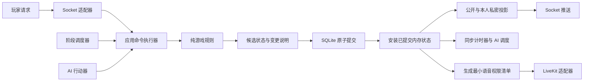
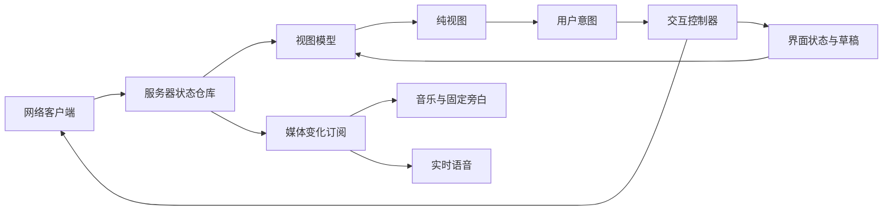

# Avalon 模块化拆分方案

> 状态：持续拆分中。本文记录已经落地的边界、迁移取舍和仍然保留的单体限制；现有运行结构见[架构说明](architecture.md)。目标目录不等于已经完成的目录。

## 当前进度

第一步已落地：`src/server/domain/roomRules.ts` 现在以无副作用纯函数计算公投和任务结果，`RoomManager` 只负责认证后的状态修改、阶段推进和计时器。真人提交、AI 行动、断线补偿和阶段到期仍共用原有入口，因此这次迁移不改变外部协议或存储格式。

同时收紧了两个依赖边界：`roomAI.ts` 依赖明确的 `RoomAIActions` 窄接口，不再导入整个 `RoomManager`；`voice.ts` 直接依赖 `RoomInternal` 数据类型，不再通过管理器方法的返回类型反向绑定实现。它们仍由 `RoomManager` 在组装处注入具体实现。

第二步已落地：`src/server/application/commandExecutor.ts` 接管命令有效期、回执幂等、会话绑定、阶段版本校验、事务提交和提交后通知。`socketHandlers.ts` 只负责 Socket.IO 字段映射、连接绑定和具体领域操作，不再自己维护命令事务的暂存集合。原有事件名、回执格式、数据库快照和客户端协议保持不变。

第三步已落地：客户端入口使用 `src/client/state/serverState.ts`、`uiState.ts`、`networkState.ts` 三个独立状态所有者，`selectors.ts` 只把它们转换成视图需要的窄上下文。公开状态按 `instanceId + revision` 丢弃旧包，队伍草稿不会因同阶段的其他人投票而被清空，网络重试集合不再和弹窗状态混在一起。

第四步已落地：错误码集中在 `src/shared/errors.ts`；私密知识使用 `knowledgeInfo`，结算使用 `winnerDetails`，展示文案只负责格式化，不再参与会话失效或目标判断。快照继续兼容 v1，v2 增加可恢复的状态版本和房间实例标识。

第五步已落地：Socket 业务命令通过 `src/server/application/roomApplicationService.ts` 统一编排；应用层只依赖 `RoomCommandPort`，不导入具体 `RoomManager`。纯流程计算移到 `src/server/domain/roomFlow.ts`。Socket 适配器迁移到 `src/server/adapters/socketHandlers.ts`，SQLite、快照与持久化迁移到 `src/server/infrastructure/`；旧路径仅保留兼容导出。AI、定时器和断线恢复仍由运行时房间状态机协调，尚未伪装成完整的候选状态领域引擎。

对应的 `roomRules.test.ts` 不启动 Socket、SQLite、LiveKit 或真实定时器，覆盖未投完不结算、严格超过半数反对、7 人以上任务 4 的两张失败牌、强制发车历史复制等规则。新增状态 store、结构化契约、快照迁移和命令执行器测试也不依赖真实公网服务。

## 1. 要解决的问题

目标不是增加目录数量，而是缩小一次修改需要理解和验证的范围。

| 当前集中点 | 实际耦合 | 拆分后的目标 |
| --- | --- | --- |
| [客户端入口](../../src/client/main.ts) | 事件绑定、渲染和媒体生命周期仍在同一组装入口 | 状态所有权已经移到 `client/state`；后续可继续拆房间控制器，不重复创建状态 |
| [房间管理器](../../src/server/roomManager.ts) | 游戏规则同时操作真实计时器、AI、恢复和会话凭证 | 规则只处理数据；应用层统一执行；运行环境单独适配 |
| [Socket 处理](../../src/server/adapters/socketHandlers.ts) | 通信层决定保存、回执、广播、语音和连接绑定的执行顺序 | Socket 只做网络边界；房间命令编排属于应用层 |
| [角色文案](../../src/client/roleLabels.ts) | 正则解析服务端中文文案，错误文字参与会话失效判断 | 错误码和结构化数据决定行为，文案只负责展示 |

继续使用一个 Node 应用、一个 SQLite 写者、Socket.IO、原生 TypeScript 前端和可选 LiveKit。Caddy 仍是外部网关，不因模块拆分增加网关或运行进程。当前不引入微服务、Redis、消息队列、事件溯源或新的前端框架。

## 2. 两条主线

### 服务端运行流程

以下是下一阶段的目标流程，不是当前全部已实现的调用链；箭头表示调用或数据流，不表示所有模块都可以互相导入。当前真人命令通过执行器提交，AI、计时和恢复仍由运行时状态机调用原业务方法，再经变更回调保存和推送。



目标是让玩家操作、AI 行动、阶段到期和离线补偿都进入应用命令执行器，并用候选状态保证提交前不可见。当前还没有实现这条统一内部命令管线，不能把已有的保存失败暂停机制写成候选状态事务。内部规则变更说明不等于网络消息，不能直接发给浏览器或写入公开日志。

### 客户端运行流程



点击选人只修改草稿；提交组队只发送意图；收到服务器确认后的状态才改变游戏阶段。打开弹窗、调整音量和倒计时数字变化，不应触发游戏状态修改或重新建立媒体连接。

## 3. 目标代码组织

以下是目标目录，不是当前已存在的目录。先移动现有模块，再在职责确实不同的地方拆文件；不为每个函数建立接口或目录。

```text
src/
  shared/
    rules/                 公开规则、角色标识、人数与任务配置
    contracts/             命令、校验 schema、视图 DTO、错误码与协议版本
  server/
    index.ts               启动入口与依赖组装
    domain/
      room.ts              房间业务数据与不变量
      commands.ts          领域命令，不含网络认证字段
      lobby.ts             加入、准备、人数、开局与房主轮换规则
      gameplay.ts          组队、投票、任务、发言、刺杀与阶段转换
      visibility.ts        身份知识与可执行动作的规则
    application/
      roomApplicationService.ts  房间命令编排与提交后调度
      roomPorts.ts               应用层房间端口
      commandExecutor.ts   幂等检查、决策、提交、提交后处理
      sessions.ts          玩家凭证校验，不依赖 Socket 对象
      queries.ts           只读查询与公开/私密投影
      recovery.ts          暂停、重连宽限与恢复编排
      voicePolicy.ts       从已提交状态生成媒体权限
      ports.ts             实际使用的存储、时间、随机与通知边界
    adapters/
      socketHandlers.ts          Socket.IO 消息与连接适配
      http/                Express、门禁、来源与 HTTP 防护
      socket/              Socket.IO、连接绑定、网络限流与消息映射
    infrastructure/
      persistence/         SQLite、快照、回执、检查点与版本迁移
      runtime/             真实时钟、随机源、Timeout 注册表与 AI 行动
      voice/               LiveKit SDK、短期授权与媒体清理
  client/
    main.ts                挂载与销毁应用，不保存游戏业务状态
    app/                   控制器、意图分发与依赖组装
    network/               Socket、命令重试、校时与本地会话存储
    state/                 服务器状态、界面状态、reducer 与 selectors
    views/                 保留并逐步窄化现有纯渲染模块
    media/                 音乐、旁白、音效和 LiveKit 客户端
    styles/                主题变量、布局、功能区与动效
```

测试继续与被测模块相邻，浏览器测试仍在 `tests/e2e`。`scripts`、`deploy`、`public` 的用途不变。当前已先完成应用服务、Socket 适配器和持久化目录的第一轮迁移，保留原入口和兼容转发模块，避免同时改动构建入口、部署命令和全部导入路径。下一阶段仍需把 `RoomManager` 中的可变状态转换与真实计时器彻底分开；在此之前，不把“候选状态提交后安装”写成当前事实。

## 4. 依赖方向与状态归属

### 允许的依赖

| 模块 | 可以依赖 | 禁止直接依赖 |
| --- | --- | --- |
| `shared/rules` | 自身与纯数据 | 客户端、服务端、Node API、DOM、SDK |
| `shared/contracts` | 公开规则标识、浏览器可用的 schema 库 | 服务端内部房间、数据库、密钥配置 |
| `server/domain` | 自身、公开规则 | Socket.IO、Express、SQLite、LiveKit、真实时钟与定时器 |
| `server/application` | domain、contracts、自身定义的 ports | 具体适配器、SDK、HTTP/Socket 对象 |
| `server/adapters` | application 暴露的接口、自身使用的 SDK | 直接修改房间或绕过应用命令执行器 |
| `client/state` | contracts、纯规则与自身 | Socket、DOM、localStorage、音频 SDK |
| `client/views` | 窄化的视图模型、展示工具与素材目录 | 网络、存储、命令执行与媒体生命周期 |
| 客户端组装层 | 客户端各模块 | 服务端内部代码 |

组装入口可以导入具体实现，将它们传给上层。接口定义在使用方需要的边界，不通过 `ReturnType<RoomManager["getRoom"]>` 或 `Pick<RoomManager, ...>` 让外部模块反向依赖整个管理器。

### 每份状态只有一个所有者（目标）

下表描述最终归属。当前权威可变状态及真实计时器仍保存在 `RoomManager` / `RoomInternal` 中；客户端三类状态仓库已经落地。

| 数据 | 所有者 | 其他模块的使用方式 |
| --- | --- | --- |
| 玩家、准备、身份、队伍、票、分数与阶段 | 应用层持有的已提交 `RoomState` | 规则接收只读输入并返回候选状态，外部不拿可变引用 |
| 会话 token、来源配额、恢复标记 | 应用层会话及运行元数据 | 显式认证或查询接口，不传入纯游戏规则 |
| 截止时间、发言人等可恢复计时计划 | 可持久化的数据状态 | 调度器按计划建立真实回调 |
| `Timeout`、Socket、SDK 连接、AI 回调句柄 | 对应适配器的注册表 | 不放进业务房间，不进入快照或网络 DTO |
| 数据库中的快照与回执 | 持久化适配器 | 使用提交接口，不由视图或广播触发写入 |
| 浏览器收到的公开与本人私密状态 | 客户端服务器状态仓库 | 只读选择与展示，本地不能推进阶段 |
| 选人草稿、弹窗、表单、展开项 | 客户端界面状态仓库 | UI 意图修改，不写回服务器状态 |
| 未确认命令与重试进度 | 网络命令模块 | 通过只读状态通知界面，不再维护第二套 pending 集合 |

领域状态可以知道玩家是否在线，因为在线状态参与当前玩法；它不需要知道对应 Socket 的 ID。领域模型按阶段使用带判别字段的类型，减少“当前是任务阶段，却带着上轮发言计时器”等无效组合。

## 5. 服务端如何真正解耦

### 5.1 规则只做决策

目标接口是 `decideRoom(state, command, context)`，返回成功的候选状态与变更说明，或者稳定的领域错误。不修改输入，不发送消息，不启动定时器。

`context` 提供显式时间和受控的随机、ID 输入；测试可以使用固定时间与随机序列。身份分配、首任队长、男女卡面仍随机产生，但重连和恢复绝不重新抽取。实际安全随机源由运行环境提供。

业务阶段仍包含揭晓、组队、公投、提案结果、任务、任务结果、发言、刺杀和结算。动画展示时长继续由服务端计时计划决定，不能由前端动画结束回调推进。

会话认证成功后，应用层把可信的行动者 ID 交给规则；规则仍检查领队、任务队员、刺客、所属阶段和重复投票，不能把“通过认证”误当成“允许执行任何动作”。

### 5.2 一条提交管线

执行顺序必须固定：

1. 网络边界执行门禁、来源、限流和严格 schema 校验；应用层校验连接身份与会话归属。
2. 按原有主体规则查找同编号回执。已有同一意图就返回原结果，不再次执行。
3. 对新意图检查有效期、容量、`phaseId` 与业务权限，基于只读状态产生候选变更。
4. 在同一个 SQLite 事务中写入所有受影响房间的候选快照和命令回执。
5. 提交成功后，才安装候选内存状态；然后同步调度、生成投影、发出通知，并返回已保存的结果。

保持单写者串行执行，在决策与 SQLite 提交之间不等待 LiveKit 或其他外部网络服务。涉及多个房间、来源限额或新建房间的操作也必须受同一协调边界保护，不能只给单房间加锁却放开全局限额。

这不是事件溯源：数据库仍保存快照和有期限的回执，不新增一套必须重放全部事件才能恢复的机制。继续保留原有回执容量、有效期、请求指纹、主体隔离以及保存失败时暂停操作的保护，不宣称永久恰好执行一次。

数据库写入失败时，候选状态不可见，不发送成功通知；提交成功但响应丢失时，重试返回原回执。媒体或通知失败不能把已经提交的动作改成失败结果，更不能重新执行投票或结算。通知通过状态补偿查询恢复，媒体失败单独报告；关键调度根据已提交计时计划重新核对。

### 5.3 定时器和 AI 不拥有规则

调度器只保存真实句柄，到期时提交内部 `PhaseExpired` 命令。命令带房间、阶段标识、计时类型和截止时间；应用层忽略旧阶段或已处理的回调。清理句柄不是唯一防线。

AI 读取该 AI 允许获得的公开状态与本人私密视图，产生普通组队、投票、任务或结束发言意图。使用受信任的内部行动者通道，不冒用玩家 session token，也不直接修改房间。AI 命令仍经过相同的阶段、角色、重复动作检查和持久化提交。

内部系统命令不能出现在客户端事件白名单中。恢复宽限、阶段到期和 AI 回调都要覆盖旧回调、重开房间及重复触发的测试。

### 5.4 查询、推送和语音分开

查询接口返回独立投影，不暴露可变 `RoomInternal`。公开视图不能携带未公开的角色和凭证；本人私密投影只能发送给已认证的对应连接。刺杀阶段只公开藏锋者，结算才公开全员身份。

推送器只读取已提交投影并发送，不负责保存数据库。LiveKit 适配器只接收最小权限清单，例如参与者 ID、显示名、是否可收听和是否可发言，而不是整个秘密房间对象。权限由应用层从已提交游戏状态派生，SDK 不参与胜负判定。

继续保留语音 epoch、短期授权和异步请求完成后的会话/权限复验。只在前端静音不算权限控制。语音故障时停止签发不可确认的新授权，不能因此回滚游戏结果；可选语音关闭时，游戏仍可运行。当前语音的传输加密方式和非端到端加密边界不因重构而改变。

## 6. 前端如何拆开

### 6.1 三类状态分开（已落地）

- 服务器状态：`ServerStateStore` 持有公开对局、本人的私密信息和会话身份，只能由服务器消息或明确的会话操作更新。
- 界面状态：`UiStateStore` 持有表单、选人草稿、任务选择、弹窗、隐藏身份和记录展开项；它不包含 Socket 或权威阶段推进能力。
- 网络状态：`NetworkStateStore` 持有连接、会话恢复、待确认命令、重连和时钟请求状态；`CommandRequests` 仍负责命令重试和回执核对。

选人草稿绑定房间和 `phaseId`。同阶段收到其他玩家投票、在线变化或补偿状态时，只移除已经无效的选择，不清空有效草稿；换领队、换阶段、离开或重开时才按规则重置。

弹窗使用带数据的单一 modal 状态，替代大量可能同时为真的布尔变量。临时叠加展示若确有需求，显式建模层级，而不是隐式拼接多个弹窗。

### 6.2 控制器、视图与媒体各司其职（已落地一部分）

当前 `main.ts` 仍是浏览器组装入口和事件控制器，但状态写入已经经过三类 store；`selectors.ts` 接收 store 并生成 `GameViewContext`。控制器接收 `SelectPlayer`、`SubmitTeam`、`OpenRole` 等意图，决定修改界面状态还是调用网络接口。服务器动作的校验和权威结论仍在服务端。

当前 selector 生成 `GameViewContext`，视图只消费显式参数，不接触 Socket 或存储；按页面继续拆成 `TableViewModel`、`ActionPanelViewModel` 等更窄模型，以及集中派生按钮可用状态，仍是后续工作。重连时若 `room:rejoin` 尚未确认，入口会复用原请求编号并在新 Socket 上重试，避免网络恢复后界面长期停留在禁用状态。

`render()` 只更新 DOM。音乐、旁白、任务音效和实时语音通过受控的状态变化订阅更新，并按房间、阶段、事件去重；打开角色卡不会重播旁白或重连语音。内部完整事件不直接广播给媒体模块，公开旁白只能使用公开事实，本人身份展示只使用本人的私密视图。

优先复用现有 `CommandRequests`、`serverClock`、`patchHtml`、`RenderEvents`、`GameAudio` 和 `VoiceChat` 的有效实现，调整接线与生命周期，而不是全部重写。模块提供显式创建、订阅和销毁接口，测试不必通过导入入口文件来启动整个应用。

样式拆分排在状态与执行边界之后。先保持 `table-theme.css` 视觉不变，后续按主题变量、布局、圆桌、弹窗和动效分区，使用明确根类限定范围；旧的未加载样式确认无构建或展示依赖后再清理，不把视觉重做混进核心重构。

## 7. 协议不再依赖中文文案

命令使用从同一组公开 schema 推导的 payload 类型，Socket 两端不再各写一套不受约束的 `string + Record<string, unknown>`。共享契约不包含服务端内部模型或真实密钥；本人角色、会话凭证等私密响应字段仍须明确标记并按接收者隔离。

| 信息 | 目标数据 | 展示职责 |
| --- | --- | --- |
| 会话失效 | 稳定的 `SESSION_INVALID` 等错误码 | 客户端选择提示文案，行为不匹配文字 |
| 身份知识 | 知识类型与允许看到的玩家 ID | 使用昵称与角色目录生成文本，派西维尔提示仍写作『梅林？』 |
| 获胜原因 | 原因类型、阵营和可公开的目标 ID | 使用统一模板，不从句子里反查玩家 |
| 当前可执行动作 | 服务端权限规则派生的 DTO | 客户端组合网络和 pending 状态决定按钮展示 |

目标协议为每个玩家发送一个同版本视图包，包含公开状态与该玩家私密状态；只能单独推送给本人连接。这样不会先展示新阶段、再短暂套用旧权限。

当前公开视图已增加持久化的 `revision` 和 `instanceId`，客户端仅接受同一房间实例的非旧版本；进入不同房间实例时清除旧比较基线，拒绝已退役实例的旧包。但公开与私密状态仍是两条消息，尚未形成同版本的单一视图包。`revision` 与 `phaseId` 用途不同：前者用于状态顺序，后者表示操作窗口；同阶段另一人投票不能使当前玩家的合法操作失效。倒计时由服务端截止时间和现有校时时钟本地显示，不为每一秒制造新状态版本。

这是协议演进，安排在内部职责拆分后单独切换，前后端一起发布，旧页面明确要求刷新；不把协议变化藏在目录移动里。

## 8. 迁移顺序

每一步均应可以独立构建和测试。除协议切换阶段外，尽量维持现有外部协议和存储格式。

| 步骤 | 已落地 | 尚未完成 |
| --- | --- | --- |
| 1. 固定边界与行为基线 | 依赖检查、关键流程回归、应用与持久化窄端口 | 随迁移继续收紧边界；现有检查不等于完整依赖图分析 |
| 2. 提取规则与状态模型 | 公投/任务判定、队长轮换、发言顺序和任务选择纯函数 | 完整不可变领域状态与候选转换 |
| 3. 统一服务端执行 | 真人业务命令的执行器、应用服务、回执和提交后异常隔离 | AI/到期/恢复内部命令、独立运行时组装和调度 |
| 4. 拆分前端状态与副作用 | 三类 store、selectors、纯视图和媒体模块 | 按页面窄化视图模型，继续提取入口控制器和样式 |
| 5. 演进契约与快照 | 错误码、结构化 DTO、v1/v2 迁移、公开 revision/instanceId | 本人公开/私密状态的同版本视图包 |
| 6. 移除兼容层 | 老 Socket/持久化路径变为薄兼容导出 | 在迁移调用方后移除不再需要的导出、旧样式和运行时耦合 |

前几步保留入口路径和兼容门面，不同时更换依赖、视觉、玩法或部署拓扑。既有大测试保留为行为保护，逐步增加窄化模块测试，不能为适应新结构而删掉失败的业务断言。

现有快照支持 v1/v2。结构变化时由持久化适配器提供明确迁移，协议版本和快照版本分开管理。必须保留原角色、男女卡面、准备/投票、回执、门禁签名材料和暂停后的剩余时间，恢复后最多 60 秒重连的约定不变。

旧结算文本保留为兼容展示字段，但新结果通过 `winnerDetails` 提供原因类型和目标 ID；私密知识通过 `knowledgeInfo` 提供类型和玩家 ID。新业务不再根据同名玩家或中文句子猜目标。数据库升级前备份；写入新格式后，回滚旧程序必须配套恢复兼容备份，不能假设旧版可读新版数据库。

## 9. 验收方式

- 依赖检查：使用现有 ESLint 和必要的解析检查约束 import/re-export，包括 type-only 导入；shared 不引用 server/client，domain 不引用 adapter 或 SDK，视图不引用网络。新增模块图不得出现循环。
- 领域测试：固定时间和随机输入，验证人数、随机分配、组队人数、多数反对、强制发车、任务 4、发言顺序与刺杀窗口；不等待真实 30/60/120 秒。
- 应用测试：用可控存储验证重复请求、同编号改内容、旧阶段、并发到期、写盘失败、提交后断线与重复结算；检查原状态未被候选计算修改。
- 隐私测试：公开 DTO、错误、通知和语音权限均不能泄露未公开身份；AI 只得到被允许的知识；本人视图包绝不能按房间广播。
- 适配器测试：真实临时 SQLite、回环 Socket、快照迁移、来源/限流/凭证边界、LiveKit 异步授权完成后的再校验。
- 客户端测试：状态 reducer、selectors、同阶段草稿、错序/重复视图、旧私密状态、弹窗切换、媒体去重与 dispose；不能用本地动画决定服务端进程。
- 端到端验证：5/10 人局、全员提前投完、倒计时到期、断线重连、强杀恢复、任务结果、发言与刺杀完整链路；同时运行现有网关与可选语音验证。
- 工程验证：保留原 npm 入口，更新移动文件对应的构建、测试、部署、文档和公开源码检查，在干净导出的项目中验证安装、构建及恢复；不依赖本机隐藏目录。

文件行数仅作提醒，不作为拆分成功的证据。真正的完成标准是：改文案不影响会话判断，改规则不必改 Socket/SQLite/LiveKit，改视图不必改重连，替换存储或媒体实现不必修改游戏判定。

## 10. 保留的限制

模块化后仍是单实例写者，不自动获得多实例扩容能力；这次不为尚未需要的分布式能力增加复杂度。数据库、网关和语音各自的安全职责也仍然存在，弱耦合不等于无需鉴权、限流、备份或传输保护。

不引入无边界的全局 EventBus、通用框架或重复的“万能服务”。提交后通知使用明确且可测试的接口，不用事件名称字符串把依赖隐藏起来。只有存在真实替换、测试或外部 I/O 边界时才增加接口。
