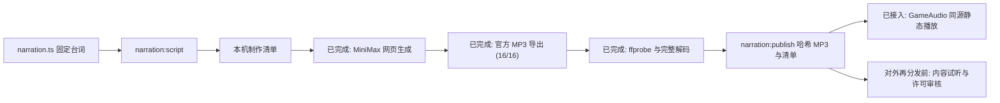

# 固定旁白制作与播放

## 当前状态

音色已选定为 MiniMax 的 **Serene Narrator - Deep,Resonant,Measured**，方向为沉稳、清晰、克制的旁白，参考语速 `0.9`、自然音高。不要改用活泼角色声，也不要用浏览器系统音色或官方示例文件冒充该音色的新制作结果。

**固定旁白已于 2026-10-20 接入 `GameAudio`。** 16 条录音全部通过 `ffprobe` 单一 MP3 音轨、大小、时长与哈希检查，以及 FFmpeg 完整解码检查。已发布的内容哈希 MP3 和清单位于 `public/assets/narration/`，浏览器实测同源 MP3 播放、成功/失败音效与离房清理通过。1 条误合并样本未发布，下载原件保留。

游戏运行时仅播放同源静态音频，已移除原有 Web Speech 路径；没有在线 TTS 服务、MiniMax SDK 或运行时密钥，玩家昵称、名单或未公开身份不发送给 MiniMax。真人通话继续由 LiveKit 提供，与旁白独立。逐句内容、主观听感和对外再分发许可仍须维护者审核，技术验收和本次功能接入不代表版权许可已确认。

2026-10-25 完成来源与技术核对；2026-10-29 维护者明确确认现有录音可以随本项目公开分发，重新核对 16/16 文件大小和摘要后已更新台账。确认范围见[录音分发说明](../../public/assets/narration/NOTICE.md)：不标为 MIT / CC0，不冒充 MiniMax 官方授权或任意下游使用权。历史审核依据见 [素材审核](../media/provenance.md)，项目自制素材的 MIT 授权不覆盖这些录音。

## 网页制作记录

2026-10-19 使用官方网页的 `speech-2.8-hd` 模型、上述音色、语速 `0.9`、音高 `0`、音量 `1`，已在账号历史记录逐条核对 16 条目标台词。有效台词实测消耗 616 个网页积分，这是本次制作记录，不是今后的免费额度或计费承诺；未购买积分、未调用付费 API。

| 源文件名 | ffprobe 时长（毫秒，上取整） | 上限（毫秒） |
| --- | --- | --- |
| `game-reveal.mp3` | 6850 | 9500 |
| `team-select.mp3` | 5422 | 28000 |
| `team-select-forced.mp3` | 6943 | 28000 |
| `team-vote.mp3` | 7420 | 28000 |
| `proposal-rejected.mp3` | 3565 | 4500 |
| `mission-play.mp3` | 9556 | 28000 |
| `mission-play-forced.mp3` | 9230 | 28000 |
| `mission-success.mp3` | 4761 | 7500 |
| `mission-failure.mp3` | 4227 | 7500 |
| `mission-three-successes.mp3` | 5086 | 7500 |
| `mission-three-failures.mp3` | 4854 | 7500 |
| `speech-start.mp3` | 1754 | 2500 |
| `speech-next.mp3` | 2369 | 2500 |
| `assassination.mp3` | 12179 | 25000 |
| `victory-good.mp3` | 2938 | 10000 |
| `victory-evil.mp3` | 3275 | 10000 |

以上是本次发布文件的 `ffprobe` 验收值，不再使用网页整数显示或 Windows 元数据作为发布依据。已发布文件名包含内容哈希，准确清单见 `public/assets/narration/manifest.json`。初次网页生成记录仍保留在忽略提交的 `.media/narration-production/web-generation-2026-10-19.json`，其当时的待验证状态是历史快照，不是当前运行状态。

自动化未能取得官方下载的本地文件，本次已由维护者通过官方页面的 `History -> 下载 -> MP3` 全部导出。文件现已到齐，不需要重复生成，也不要绕过浏览器安全限制提取内部音频地址。历史中另有一条误将开场与发车失败台词拼在一起的音频，文本为“游戏开始。请查看自己的身份，十秒后进入组队阶段。队伍未通过，下一位队长组队。”，已排除在正式包外；它另消耗 71 个网页积分。

## 本地接收记录

2026-10-20 已检查下载目录中的 17 个官方 MP3：16 个按生成时间与网页历史记录的独立台词匹配，复制到 `.media/narration-production/clips/<cue-id>.mp3`；`MiniMax_2026-10-19_20_45_04_Serene_Narrator.mp3` 是误合并样本，未复制到该目录。全部下载原件均保留。文件名和生成时间的匹配不能证明实际朗读内容正确，台词仍需逐条试听确认。

16 个文件均为非空普通文件，复制前后的 SHA-256 一致。最初的 Windows 元数据初检已完成；随后使用 `ffprobe` 验证全部文件，并用 FFmpeg 对每条执行完整解码，零错误。短发言提示的最终验收时长分别为 1754、2369 毫秒，均低于 2500 毫秒上限。当前 16/16 个文件已发布并接入播放器。

当前接收状态记录在忽略提交的 `.media/narration-production/local-download-status.json`；`web-generation-2026-10-19.json` 保留为 2026-10-19 网页制作完成时的历史快照。手动下载成功将排查范围缩小到自动化点击或文件接收环节，但尚不能确认具体故障机制，也不应再将所有官方下载失败笼统描述为安全限制。

本次校验工具来自 [FFmpeg 官网列出的 Windows 构建渠道](https://ffmpeg.org/download.html)及 [Gyan 的发行构建](https://www.gyan.dev/ffmpeg/builds/)，使用 9.0.2 essentials；压缩包已对照发布方 SHA-256 验证。工具仅解压到忽略提交的 `.tools/ffmpeg-9.0.2-essentials_build`，未修改系统 PATH。正常克隆、构建和运行游戏不需要此目录；只有重新验收/发布录音时需要可用 `ffprobe`。

## 台词与制作

唯一台词源为 `src/shared/narration.ts` 的 `NARRATION_CUES`，当前共 16 条。`NARRATION_VOICE` 记录已确认的显示名称、语速和风格；网页音色条目的内部数字不能默认当作 API 的 `voice_id`，本工具也不调用 API。

```bash
npm run narration:script
```

需要先安装开发依赖。命令在忽略提交的 `.media/narration-production/` 导出：

- `script.md`：逐句文件名、台词和最大时长。
- `script.json`：带 `awaiting-generation` 状态的结构化制作清单。
- `lines.txt`：按清单顺序排列的纯台词，每句之间空一行。

`script.json` 中的 `awaiting-generation` 是工具导出的制作模板状态，工具不会读取或同步 MiniMax 网页历史；实际网页制作进度以上述记录为准，文件验收仍以实际 MP3 为准。

导出不会生成声音，不登录第三方、不产生网络请求或付费调用。音色生成和导出仍需要维护者在可用的 MiniMax 官方页面操作；免费额度是否足够、下载条件及公开再分发权限，需按所用产品和账号实际条款核实。不得自动购买、绕过额度或将 API Key/登录凭证提交到 Git。

每句单独导出 MP3，按清单命名。不要把编号、文件名、时长、风格说明一并朗读，也不要把整份 Markdown 直接作为台词。可先制作短样本核对音色和发音，再制作其他句子；若批量生成一整段，须在音频编辑工具中按句准确切分并逐条试听，不能直接将整段文件重复用于不同阶段。

## 验收

```bash
npm run narration:verify -- .media/narration-production/clips
```

`clips` 是实际 MP3 文件所在目录，工具不会创建或伪造缺失音频。需本机已有 `ffprobe`（FFmpeg 的配套工具），或者配置 `FFPROBE_BIN` 为其可执行文件的绝对路径。工具不自动下载或安装软件。

检查包括：全部 16 个预期文件、普通文件而非符号链接、非空且每个不超过 10 MiB、单一 MP3 音轨、有限且为正的实际时长、阶段时长上限，以及内容 SHA-256。`ffprobe` 使用参数数组调用，不通过 shell 拼接文件路径；外部进程有超时和输出上限。校验只读取文件并输出报告，不发布静态资源、不写游戏配置。

5 秒发车失败展示对应音频不超过 4.5 秒，8 秒任务结果展示不超过 7.5 秒，10 秒身份揭晓不超过 9.5 秒。AI 发言只停留 3 秒，发言提示均不超过 2.5 秒。音频首尾留白也计入时长；超长应缩短台词或重新制作，不能延长服务器计时来迁就旁白。

文件格式、时长校验不能证明台词正确、音色一致或授权有效。必须人工试听确认每个文件与其编号匹配，没有截断、重复、杂音、错读、意外水印或朗读的标记；同时记录所用产品和生成音频的使用许可。现有 `.media/narration-preview/official-*.mp3` 只是官方音色示例，不是正式台词，不属于待发布旁白包。

## 发布音频包

```bash
npm run narration:publish -- .media/narration-production/clips
npm run typecheck
npm test
npm run build
```

发布命令复用完整包验收，之后将音频写成 `<cue-id>.<sha256前12位>.mp3`，最后更新 `public/assets/narration/manifest.json`。清单包含音色、包版本、每条时长、字节数和完整 SHA-256。源文件在发布中改变、输入缺失或目标哈希文件内容冲突时失败，不用部分包替换现有清单；相同输入可重复发布，不改变原件。生成的静态文件需要与源代码一起保留，日常构建不再执行音频生成或校验程序。

前端在编译时导入清单，不在运行时请求 MiniMax 或获取动态音频地址。更换音频后必须重新构建并同时部署前端与音频；哈希文件名避免旧缓存继续播放旧录音。脚本不自动删除旧哈希文件，部署时宜保留一段时间，供尚未刷新的旧客户端使用。公开再分发前应完成主观试听与许可审核；本仓库不将这些录音标为 CC0。

## 运行时约定

`GameAudio` 已调用 `narrationCue(current, previous)`，只从 `PublicRoomState` 选择固定编号，不依赖 DOM、用户昵称、胜负原因文本或 `PrivatePlayerState`：

- 强制发车和正常投票通过分别使用不同提示，不伪造全员赞成。
- 发车失败后直接提示下一位队长组队，不提示进入发言。
- 普通任务结果后提示发言；累计三次失败提示藏锋者获胜，累计三次成功提示随后进入讨论与刺杀。
- 刺杀阶段明确藏锋者身份已公开、讨论全房间可听；最终胜负分别使用固定台词，不拼接玩家昵称或胜负原因。
- 新增结果只在相邻同房快照出现新增历史时选择结果音频，首次加入/重连不补播结果；发言心跳或同一发言人的计时更新不重复选择发言提示。

音乐、旁白、结果音效为独立音轨和偏好，仍使用 `awalong-audio` 本机设置，房主默认开启旁白，其他玩家可自愿开启。首次点击/按键解锁播放；旁白音量可即时调整，不重播。播放中音乐降至设定音量的 20%，实时语音连接同样可独立保持音乐压低。任务成功、失败和发车失败保留原独立 WAV 音效。

新旁白使用独立 `HTMLAudioElement`；切阶段、断线、离房、关闭旁白及销毁时取消旧播放并释放资源。事件和 `play()` Promise 使用代次及音轨对象校验；加载停滞有有界看门狗，剩余时间不足的迟到录音不启动。自动播放被拦截后只等待下一次操作重试，文件加载失败提示错误，不回退系统或在线 TTS。任何音频回调都不发送推进阶段的请求，不修改服务器截止时间。



后续修改必须保留首次操作解锁、房主默认开启、其他玩家自愿开启、音量设置、音乐压低、阶段去重、断线/退出取消与过期回调隔离。不要延长服务器计时适配超长录音，也不要新增线上 TTS 代理或未经确认更换音色。

进程恢复宽限期间不选取旁白或结果音；恢复完成不补播停机前的任务/发车结果。恢复标识参与播报去重，后续新的正常阶段仍可播报，不修改预生成音频或增加在线服务。

## 音频接入时验收记录

- 全量 547 项回归、音频相关 63 项回归、TypeScript 检查和前后端构建通过。
- 16 条 MP3 的单一音轨、大小、时长与哈希检查通过，16 条完整解码零错误。
- 本机生产构建的 16 条音频 HTTP 200、`audio/mpeg`、内容哈希检查通过，分段读取返回 HTTP 206。
- 隔离的单机测试对局中实际观察到同源 MP3 播放、独立成功/失败 WAV 播放、声音设置与离房后的音轨清理；浏览器无错误日志。
- 本机明细保存在 `.media/narration-production/browser-verification.json`、`local-download-status.json`，不包含运行时 TTS 密钥，也不作为人工主观听感或再分发许可的证明。
